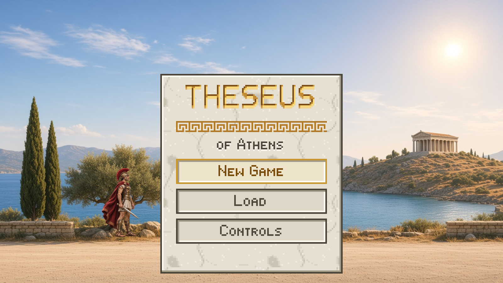

# Theseus

A left-to-right side scroller. Theseus runs the road from Athens to a guarded temple, along a rocky coast, through a sacred city, into cypress-covered mountain terraces, and across a rocky gorge lined with ancient temples. The art is small and sharp, in the spirit of early SNES platformers.

## Contents

- [Screenshots](#screenshots)
- [The journey](#the-journey)
  - [The Temple Road](#the-temple-road)
  - [The Rocky Coast](#the-rocky-coast)
  - [The Sacred City](#the-sacred-city)
  - [The Mountain Sanctuary](#the-mountain-sanctuary)
  - [The Gorge Sanctuary](#the-gorge-sanctuary)
- [How to play](#how-to-play)
- [Credits](#credits)
- [Play-test any level](#play-test-any-level)

## Screenshots

### Title



### Broken Colonnade


## The journey

Light a shrine to keep your place. Entering a new level also saves its entrance. Death returns you to that entrance or the latest shrine with full health. Load resumes the highest level or shrine reached in the current session. New Game starts the road over.

### The Temple Road

The opening level is a 4,800-pixel road in five stretches: the King's Road, the Broken Colonnade, the Olive Terraces, the Ruined Aqueduct, and the Temple Approach. Sixteen soldiers wait along it — raiders, peltasts, and hoplites — with health flasks and two shrines. The temple gate stays shut until its guard falls.

[Level 1 guide](docs/level_1.md)

### The Rocky Coast

Clear the temple and the road continues onto limestone cliffs above the sea. Birds cross the sky, telchines jab from the ledges, and spartoi hold the landings. The coast is taller than the road, so the view follows Theseus up and down. A sanctuary closes the level.

[Level 2 guide](docs/level_2.md)

### The Sacred City

The third level is a Greek town: houses, tiled roofs, an agora, and the climb to the acropolis. Lamia share the streets with hoplites, peltasts, and spartoi. The temple at the top opens the way into the mountains.

[Level 3 guide](docs/level_3.md)

### The Mountain Sanctuary

Cypress trees rise above Greek mountain slopes and terraced stone walls. Cyclops Slingers hurl breakable boulders, Satyrs hop between ledges and charge with their horns, and Raiders and Telchines return. Four spike pits interrupt the road: jump across, or climb out after losing a health bar. Satyrs can be bounced on and sometimes drop stolen wine for a brief speed boost.

[Level 4 guide](docs/level_4.md)

### The Gorge Sanctuary

Pale limestone cliffs, dark clefts, ruined temples, and stone causeways frame the fifth level. Bronze Bulls charge along flat corridors, Cerberus Pups pursue in pairs, and a three-headed Hydra guards the exit. Two optional high flask ledges reward riding a staggered bull. The main route uses normal jumps, with two spike pits and two checkpoint shrines.

[Level 5 guide](docs/level_5.md)

## How to play

Theseus runs, jumps, ducks, and thrusts. A short jump is a released jump. Sword hits and a jump into an enemy each cost that enemy one health; landing on a Satyr bounces Theseus safely. Theseus has five health. Flasks restore two, and they never fill him past five. Stolen wine grants six seconds of extra speed. Spike pits cost one health bar per damaging contact and have enough room to jump out.

| Action | Keys |
| --- | --- |
| Move left | A / Left arrow |
| Move right | D / Right arrow |
| Jump | W / Up arrow |
| Duck | S / Down arrow |
| Sword | Space |
| Downward thrust | Hold Duck + Sword while airborne |
| Pause | Escape |

Controls on the title screen rebinds these keys for the next time you play.

The Bronze Bull is available in a separate review arena. Jump its committed charge, or use a downward thrust on its back to stagger it and ride it briefly. Its cool sheen marks the safe platform; amber warns that it is recovering. Run `godot --path . res://scenes/reviews/bronze_bull_review.tscn` to try it, or open that scene and press **F6**. The pose gallery pauses the fight.

## Credits

Music by <a href="https://pixabay.com/users/moonpub-15209240/?utm_source=link-attribution&utm_medium=referral&utm_campaign=music&utm_content=621132">Johnny Hoeve</a> from <a href="https://pixabay.com/music//?utm_source=link-attribution&utm_medium=referral&utm_campaign=music&utm_content=621132">Pixabay</a>

Sound effect by <a href="https://pixabay.com/users/daviddumaisaudio-41768500/?utm_source=link-attribution&utm_medium=referral&utm_campaign=music&utm_content=185432">David Dumais</a> from <a href="https://pixabay.com/sound-effects//?utm_source=link-attribution&utm_medium=referral&utm_campaign=music&utm_content=185432">Pixabay</a>

Sound effect by <a href="https://pixabay.com/users/u_qqkrn9bn55-52083300/?utm_source=link-attribution&utm_medium=referral&utm_campaign=music&utm_content=398256">u_qqkrn9bn55</a> from <a href="https://pixabay.com/sound-effects//?utm_source=link-attribution&utm_medium=referral&utm_campaign=music&utm_content=398256">Pixabay</a>

Sound Effect by <a href="https://pixabay.com/users/dragon-studio-38165424/?utm_source=link-attribution&utm_medium=referral&utm_campaign=music&utm_content=515257">DRAGON-STUDIO</a> from <a href="https://pixabay.com/sound-effects//?utm_source=link-attribution&utm_medium=referral&utm_campaign=music&utm_content=515257">Pixabay</a>

## Play-test any level

To review Cerberus Pups, run `godot --path . res://scenes/reviews/cerberus_pup_review.tscn`, or open that scene and press **F6**. The two hounds run together and take turns making a telegraphed leap. Jump over the attack or interrupt it with a sword hit. Each pup has two health bars; the surviving pup continues to pursue Theseus.

To review the Hydra, run `godot --path . res://scenes/reviews/hydra_review.tscn`, or open that scene and press **F6**. Each of its three heads has two health and a separate hit area. Cut down every head to defeat it; hitting the coiled body does no damage. Jump to reach the higher heads, or counter their telegraphed bites as they dip toward Theseus. Severed heads stay gone, and the survivors continue taking turns attacking.

Start any level at its entrance or at one of its shrines:

```sh
tools/play_level.sh        # choose a level and shrine from a menu
tools/play_level.sh 3      # Level 3 from the entrance
tools/play_level.sh 3 2    # Level 3 from its second shrine
```

To skip the wrapper script, run `godot --path . res://scenes/debug/level_select.tscn -- --level=3 --shrine=2`, or open `scenes/debug/level_select.tscn` in the editor and press **F6**. A shrine start counts that shrine as lit. Enemies before it are still alive, and the score starts at 0.
