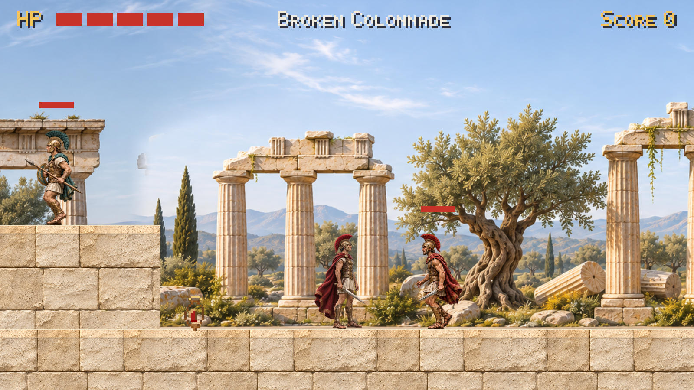
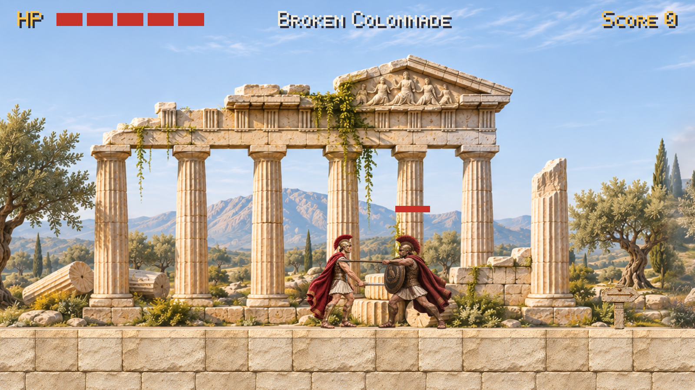

# Theseus

A left-to-right side scroller. Theseus runs the road from Athens to a guarded temple, then along a rocky coast, and finally through a sacred city. The art is small and sharp, in the spirit of early SNES platformers.

## Contents

- [Screenshots](#screenshots)
- [The journey](#the-journey)
  - [The Temple Road](#the-temple-road)
  - [The Rocky Coast](#the-rocky-coast)
  - [The Sacred City](#the-sacred-city)
- [How to play](#how-to-play)
- [Credits](#credits)
- [Play-test any level](#play-test-any-level)

## Screenshots

### Title


### Broken Colonnade





## The journey

Light a shrine to keep your place. Death returns you there with full health. Load on the title screen resumes the latest shrine from the current session. New Game starts the road over.

### The Temple Road

The opening level is a 4,800-pixel road in five stretches: the King's Road, the Broken Colonnade, the Olive Terraces, the Ruined Aqueduct, and the Temple Approach. Sixteen soldiers wait along it — raiders, peltasts, and hoplites — with health flasks and two shrines. The temple gate stays shut until its guard falls.

[Level 1 guide](docs/level_1.md)

### The Rocky Coast

Clear the temple and the road continues onto limestone cliffs above the sea. Birds cross the sky, telchines jab from the ledges, and spartoi hold the landings. The coast is taller than the road, so the view follows Theseus up and down. A sanctuary closes the level.

[Level 2 guide](docs/level_2.md)

### The Sacred City

The last stretch is a Greek town: houses, tiled roofs, an agora, and the climb to the acropolis. Lamia share the streets with hoplites, peltasts, and spartoi. The temple at the top is the exit.

[Level 3 guide](docs/level_3.md)

## How to play

Theseus runs, jumps, ducks, and thrusts. A short jump is a released jump. Sword hits and a jump into an enemy each cost that enemy one health. Theseus has five health. Flasks restore two, and they never fill him past five.

| Action | Keys |
| --- | --- |
| Move left | A / Left arrow |
| Move right | D / Right arrow |
| Jump | W / Up arrow |
| Duck | S / Down arrow |
| Sword | Space |
| Pause | Escape |

Controls on the title screen rebinds these keys for the next time you play.

## Credits

Music by <a href="https://pixabay.com/users/moonpub-15209240/?utm_source=link-attribution&utm_medium=referral&utm_campaign=music&utm_content=621132">Johnny Hoeve</a> from <a href="https://pixabay.com/music//?utm_source=link-attribution&utm_medium=referral&utm_campaign=music&utm_content=621132">Pixabay</a>

Sound effect by <a href="https://pixabay.com/users/daviddumaisaudio-41768500/?utm_source=link-attribution&utm_medium=referral&utm_campaign=music&utm_content=185432">David Dumais</a> from <a href="https://pixabay.com/sound-effects//?utm_source=link-attribution&utm_medium=referral&utm_campaign=music&utm_content=185432">Pixabay</a>

Sound effect by <a href="https://pixabay.com/users/u_qqkrn9bn55-52083300/?utm_source=link-attribution&utm_medium=referral&utm_campaign=music&utm_content=398256">u_qqkrn9bn55</a> from <a href="https://pixabay.com/sound-effects//?utm_source=link-attribution&utm_medium=referral&utm_campaign=music&utm_content=398256">Pixabay</a>

## Play-test any level

Start any level at its entrance or at one of its shrines:

```sh
tools/play_level.sh        # choose a level and shrine from a menu
tools/play_level.sh 3      # Level 3 from the entrance
tools/play_level.sh 3 2    # Level 3 from its second shrine
```

To skip the wrapper script, run `godot --path . res://scenes/debug/level_select.tscn -- --level=3 --shrine=2`, or open `scenes/debug/level_select.tscn` in the editor and press **F6**. A shrine start counts that shrine as lit. Enemies before it are still alive, and the score starts at 0.
