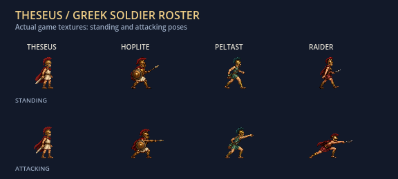

# Greek soldier enemies

Theseus is the visual reference for all three enemies: warm skin, shaded bronze,
readable helmets, adult human proportions, layered cloth, and articulated limbs.
The replacement sheets use the same 72×56 animation cells, right-facing artwork,
and nearest-neighbor rendering as the player. Enemy feet share pixel row 53.

Level 2 adds [three coastal enemies](level_2.md): bronze Stymphalian Birds,
dog-headed Telchines, and skeletal Spartoi. Their original sheets use the same
72×56 cells and material shading. Telchines inherit Peltast's held melee jab;
Spartoi inherit Raider's committed lunge. Their feet also use row 53. Bird wing
frames stay above the body, with their lowest visible pixel on row 32; their
22×8 core is centered on the flight lane. The source prompts are recorded in
[level_2_sprite_prompts.json](level_2_sprite_prompts.json).

| Enemy | Visual identity | Combat role | Atlas |
| --- | --- | --- | --- |
| Hoplite | Bronze cuirass, round shield, red-crested helmet, spear | Crouches on guard, stands when approached, marches and thrusts; takes two sword hits | `hoplite.png`, 9 frames |
| Peltast | Teal tunic and crest, bronze helmet, short javelin held in both hands | Patrols, plants his feet, telegraphs a short melee jab, then recovers; never throws the weapon | `peltast.png`, 7 frames |
| Raider | Crimson tunic and cape, bronze helmet, curved iron sword | Engages nearby visible targets, telegraphs a short sword lunge, then recovers without contact damage | `raider.png`, 7 frames |

Artwork lives in `assets/art/characters/`; corresponding scripts and scenes live
in `scenes/enemies/`. Level instances use the same names. Patrol placement,
damage, and scoring are retained. Collision heights, the
hoplite's spear strike, and the peltast's held-javelin hitbox fit the artwork.
The hoplite's crouch/rise collision box follows its stance.

The Raider has a 0.45-second windup, a 0.22-second lunge at 120 pixels/second,
and a 0.85-second recovery. He commits to his windup direction and hits each
target at most once per lunge, using a sword hitbox rather than body contact.
He attacks only within 64 horizontal pixels and 24 vertical pixels, with a clear
line of sight and safe space to lunge. Sword hits still deal damage in every
state. His fire effect has been removed.

Test the Raider's engagement, damage, telegraph, recovery, and terrain safety:

```sh
godot --headless --path . --script res://tests/raider_behavior.gd --fixed-fps 60
```

## Peltast melee javelin

The Peltast retains his placement, two health points, and 100-point score. His
weapon is always held: four walk frames, windup, short two-handed jab, and recovery.
No projectile is created, and the unused projectile scene, script, and texture
have been removed.

He waits when farther than 192 horizontal pixels from Theseus and starts an
attack only within 38 horizontal and 12 vertical pixels, with clear line of
sight. His 0.5-second windup locks his facing direction, followed by a stationary
0.18-second jab and 0.8-second recovery. Only the attached weapon hitbox deals
attack damage, once per jab; ordinary body overlap during patrol, windup, and
recovery is safe. Landing on an enemy's head follows the collision rule below.

Back away, jump over the jab, or move past the committed windup to make it miss.
Sword hits work in every state. There is no state-specific instant stomp defeat.
Raider and Hoplite retain their respective sword-lunge and spear-thrust attacks.

```sh
godot --headless --path . --script res://tests/peltast_behavior.gd --fixed-fps 60
```

## Combat focus

Raider, Spartoi, Peltast, Telchine, and Hoplite keep a live target between
attacks. They face Theseus and close to melee distance, then hold a planted
stance while their attack cooldown runs. Recovery no longer sends them back
into a patrol that turns away from the player. Pursuit can cross their original
patrol endpoints on supported ground; walls and unsupported edges make them
stop and keep watching the target instead of reversing or falling.

Raider/Peltast families acquire a visible player within 96 horizontal and 48
vertical pixels. Hoplite retains his 80-by-36-pixel wake-up range and crouch/rise
sequence, now facing the approaching player. Focus persists within 224 horizontal
and 96 vertical pixels, including jumps and temporary obstructions. It ends
when the target escapes that range, dies, or leaves the scene. Targets cannot
be acquired through walls.

Windups and active attacks still commit to their original direction. Moving
behind a windup remains a defense; soldiers turn toward the new side in recovery
or their next movement phase. Cooldowns, movement speeds, damage, and health
are retained. Lamia remains anchored to her coils, and birds use their existing
flight lanes.

Hoplite's spear detector now remains available between physics frames and is
read only during thrusts. Previously, switching it off and on every tick erased
its overlaps and could make thrusts miss entirely. Each thrust can damage its
target once, with a clear line of sight; passive body contact retains the
player's existing damage cooldown.

```sh
godot --headless --path . --script res://tests/enemy_focus.gd --fixed-fps 60
```

This regression runs sustained fights for all five soldier variants, checking
multiple attacks and hits, target-facing movement beyond patrol bounds, changing
sides, jumping, escape/death release, acquisition line of sight, and holding
position at walls and ledges. Existing attack, player-combat, Lamia, bird, and
three level integration suites also pass.

## Player hits and landing collisions

A landing from above is a collision: Theseus loses one health and the enemy
loses one health, regardless of enemy type or stance. A full-health enemy survives
the first impact. A later damaging impact can defeat an enemy with one health
remaining, awarding points once. The player's existing recoil and invulnerability
window prevent repeated damage from the same overlap or free damage while immune.
Side grazes do not count as landing collisions; detection uses the enemy's actual
current collision shape, including lowered attack stances.

Sword damage requires an explicit attack and the middle, extended-blade frame.
Windup, recovery, expired swings, and interrupted animations cannot hit. Each swing
damages a target at most once, using the blade's current position and facing.

```sh
godot --headless --path . --script res://tests/player_combat.gd --fixed-fps 60
```

## Review



The comparison uses actual game textures at native pixel size. Test the enemies
in Level 1 with:

```sh
godot --path . --scene res://scenes/levels/level_1.tscn
```

Artwork was created with the built-in imagegen tool using the player sprite sheet
as the style reference, then packed into the game's fixed-size atlas cells with
Godot's Image API. Production art briefs adapted from the generation prompts are
recorded in [enemy_sprite_prompts.json](enemy_sprite_prompts.json), using neutral
source-atlas descriptions and the current soldier names throughout.

## Validation

- Godot 4.7.2 imported all renamed scenes and textures successfully.
- All 23 frames have transparent margins, fit their atlas cells, and end on foot row 53.
- A focused engine smoke test passed for all animation regions, crouch/rise
  collision heights, spear strike height, javelin strike height, lunge/recovery,
  damage vulnerabilities, and the combined 350-point defeat score.
- Level 1 completed a 300-frame run without runtime errors.
- Godot reports an MP3 stream/playback leak at shutdown from the existing music
  autoload; the same warning occurs in the art-only packing and preview runs,
  which do not instantiate any enemies.
