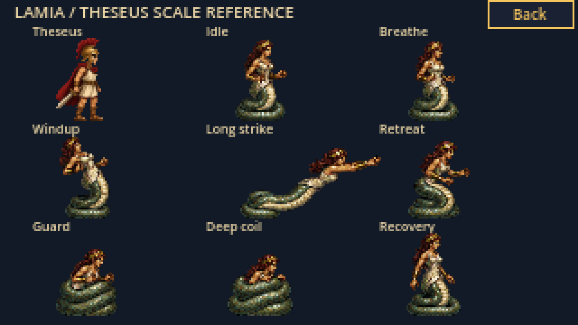
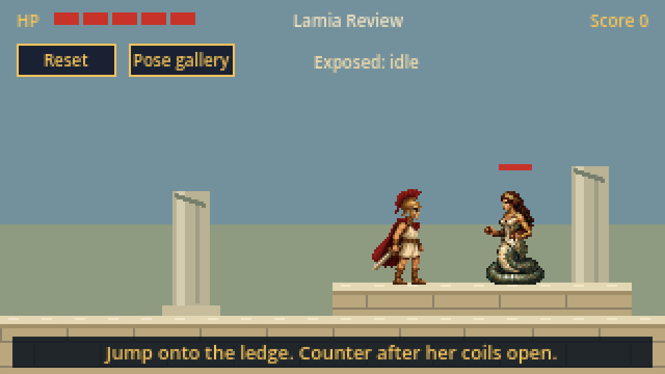

# Lamia artwork milestone

Lamia is a reusable enemy for the planned Greek town level. This milestone adds
her original sprite atlas, combat controller, and an isolated review scene.
Campaign levels and progression are unchanged; Level 3 follows after review.



Her clothed Greek upper body, bronze diadem and bracers, auburn hair, and
olive-scaled serpent tail use Theseus's shaded pixel-art style. Eight 96×56
cells give the long strike room to stretch while the tail remains planted.
The tail anchor is x=28; the ground row is 53, matching the other enemies.

| Frame | Pose |
| --- | --- |
| 0–1 | Upright resting coils, subtle breathing |
| 2 | Drawn-back windup |
| 3 | Full uncoiling melee strike |
| 4 | Retreat into coils |
| 5–6 | Raised protective coils, lowered torso |
| 7 | Exposed uncoiling recovery |

The final asset is `assets/art/characters/lamia.png`. It was generated using
the built-in imagegen tool, with Theseus and Peltast as style references, then
normalized and packed with Godot's Image API. The exact prompt and packing
settings are in [lamia_sprite_prompt.json](lamia_sprite_prompt.json).

## Review in Godot

```sh
godot --path . --scene res://scenes/reviews/lamia_review.tscn
```

Move and jump onto the platform, then use the sword. **Pose gallery** (or Escape)
pauses combat and displays all eight poses beside Theseus at the same scale.
**Back** (or Escape) resumes; **Reset** restores both actors for another review.
The label shows the current attack phase and whether Lamia is protected.
This scene leaves the campaign's checkpoint state untouched.



## Behavior

Lamia stays anchored on her platform. A living player within 68 horizontal and
16 vertical pixels, with a clear line of sight, triggers a 0.6-second windup.
She locks her facing and extends an attached melee hitbox for 0.2 seconds,
dealing one health bar at most once per attack. There are no projectiles or
passive contact attacks. Back out of reach, jump over the strike, or move
behind the committed windup to avoid it.

After striking she retracts for 0.18 seconds and protects herself within her
coils for 0.65 seconds. Both phases block damage, including sword and landing
collision damage. The lower pose and cool tint identify this protection.
Landing on a protected coil can still hurt Theseus. She then exposes herself
for a 0.7-second recovery, followed by a 0.8-second idle cooldown before another
windup can start. Counter while she is exposed. Two successful sword hits
defeat her, awarding 150 points.

The physical body stays over the anchored coils; the long reaching hands use
a separate attack hitbox. This prevents an attack across a ledge or toward a
wall from dragging her body off its platform. Walls block engagement and damage.

## Validation

```sh
godot --headless --path . --script res://tests/lamia_behavior.gd --fixed-fps 60
```

The test checks all atlas cells, ground alignment, attack range and elevation,
line of sight, a wall added during windup, direction commitment, single-hit
damage, retreat and jump defenses, protected coils, recovery vulnerability,
mirroring, defeat score, gallery pause/resume, platform access using Theseus's
actual jump, actual sword queries against both protected and exposed states,
and review Reset. The static gallery and animated preview were rendered from
the game textures in Godot.
