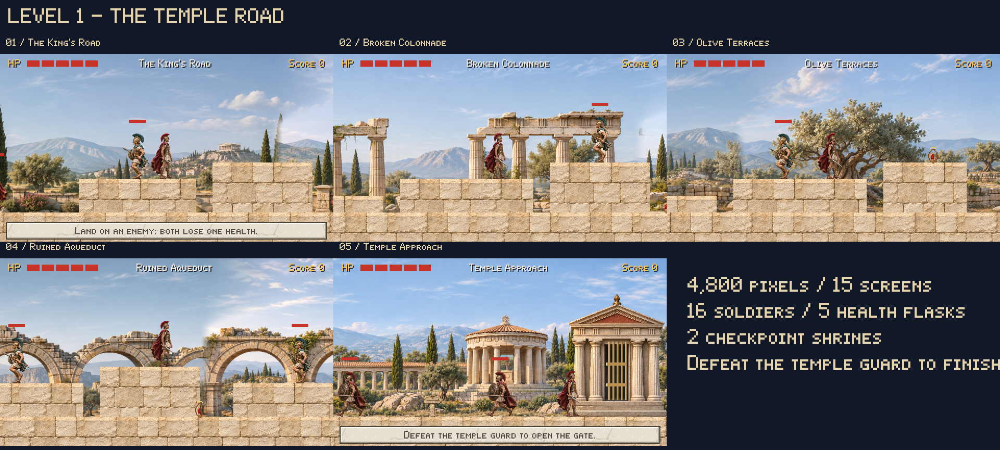
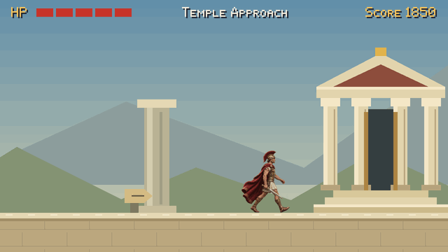

# Level 1 — The Temple Road

A complete, left-to-right opening level built from the original 960-pixel test
course. The route is now **4,800 pixels long**, or fifteen 320-pixel screens,
leading from a cypress-lined road to the guarded temple entrance.



## Cinematic scenery

Each of the five areas has two connected cinematic 3D-style panoramas, with
sunlit limestone, cypress trees, olive groves, distant mountains, ruined
colonnades, aqueduct arches, and sanctuary architecture. The panels blend at
their edges and preserve their natural proportions. Detailed masonry textures
cover the original walkable surfaces; carved waystones and a matching temple
facade complete the scenery. These are pre-rendered backgrounds in the existing
2D game, with the same collision rectangles, camera limits, and encounter layout.

## Route and encounter progression

| Area | World X | Purpose | Encounters |
| --- | --- | --- | --- |
| The King's Road | 0–959 | Establish run, full-height jump, and attack timing using the original raider, two raised platforms, peltast, and hoplite sequence. Short prompts introduce the enemy openings. | 1 Raider, 1 Peltast, 1 Hoplite |
| Broken Colonnade | 960–1919 | Climb a staircase of 16-pixel rises, then handle separate close-combat encounters after the drop. The first shrine follows the encounter stretch. | 1 Peltast, 1 Raider, 1 Hoplite |
| Olive Terraces | 1920–2879 | Apply the learned timings around an elevated javelin fighter. A health flask on the upper terrace rewards climbing; the ground catches missed jumps. | 2 Raiders, 1 Peltast |
| Ruined Aqueduct | 2880–3839 | Cross ascending and descending stone terraces, with two separated javelin fighters and a final spear guard. The second shrine follows. | 2 Peltasts, 1 Hoplite |
| Temple Approach | 3840–4799 | Remix the three soldier types in sequence. Defeat the named temple guard to raise the gate, then enter to complete Level 1. | 1 Raider, 1 Peltast, 2 Hoplites |

[Open the route map](level_1_map.svg) for exact enemy, pickup, shrine, and terrace positions.

There are **16 soldiers**, **5 health flasks**, and **2 checkpoint shrines**. The
maximum combat score is **1,850**: five Hoplites at 150 points, six Peltasts at
100, and five Raiders at 100. Earlier enemies can be bypassed; only the temple
guard must be defeated to finish.

## Movement and fairness

The player's existing movement remains unchanged: speed 90 px/s, jump velocity
−260 px/s, and gravity 900 px/s². A held jump reaches about 38 pixels vertically
and 52 pixels horizontally on level ground. Required upward steps stay at 16–32
pixels, with broad stone landing surfaces. Most uphill gaps are 16 pixels; the
32-pixel gaps occur while descending. Continuous ground makes a missed terrace
jump recoverable. There are no blind lethal pits.

The first two raised platforms retain the test course's positions and heights.
Later terrain repeats and extends that pattern. Raiders occupy open ground;
Peltasts occupy readable raised positions; Hoplites guard ground approaches.
Raiders start their sword windup only against visible targets within 64 horizontal
and 24 vertical pixels, and their lunges respect terrain and patrol bounds.
Peltasts wait outside 192 horizontal pixels and engage only within 38 horizontal
and 12 vertical pixels. They use a held javelin for a stationary, telegraphed jab,
followed by a safe recovery window. There are no ranged enemy attacks.

Duck remains available, but the route does not require crouch-walking. First-clear
pacing is intended to be roughly **2–4 minutes** with combat and exploration;
this is a design target for human playtesting. The automated combat-free route
takes approximately **53 simulated seconds** and uses 15 jumps.

Landing on an enemy's head costs **one health for both Theseus and the enemy**.
It does not instantly defeat an enemy at full health. Side grazes do not count,
and the existing invulnerability window prevents repeated collision damage.
Sword damage occurs only while the blade is visibly extended during an attack.

## Recovery and completion

- Health flasks restore two health and remain available when Theseus is already full.
- Shrines at X=1920 and X=3840 snapshot score, defeated enemies, collected
  flasks, and a safe spawn just beyond the shrine. They do not restore health.
- Death reloads Level 1 at the latest shrine with full health. Everything after
  that checkpoint resets, including its score gains, enemies, and pickups.
- Backtracking to an earlier shrine cannot replace a later checkpoint.
- Checkpoints last for the current run. New Game and Replay Level start fresh;
  disk saving is a separate feature.
- The temple gate remains physically closed until its guard is defeated. Reaching
  the open temple pauses combat while Theseus walks up the steps and fades into
  the doorway. The level-clear screen appears after he has entered, showing
  score, defeated count, and time, with Continue to Level 2, Replay Level, and
  Return to Title buttons. Entering [Level 2](level_2.md) replaces the old shrine
  with a checkpoint at the coastal entrance; Load resumes that level from then on.



## Editing and validation

`scenes/levels/level_1_layout.gd` contains the route, terraces, enemy patrols,
pickup positions, shrine positions, and tutorial prompts. `level_1_geometry.gd`
inherits the original collision construction from `level_geometry.gd`, then
renders the cinematic panoramas and stone surfaces. Each section texture in
`assets/art/backgrounds/level_1/` contains its west and east panels stacked
vertically. `level_1_temple.gd` renders the cinematic facade shared by Levels 1–3,
leaving gate collision, unlocking, and entry logic on the existing temple.
Levels 4–5 keep their existing renderers. Scenery is also visible in the editor.
`level_1.gd` builds the encounters and manages
checkpoints, camera limits, pause, and completion. Enemy and pickup instances are
created from their existing reusable scenes at runtime.

Play the level directly:

```sh
godot --path . --scene res://scenes/levels/level_1.tscn
```

Run the integration checks:

```sh
godot --headless --path . --import
godot --headless --path . --script res://tests/level_1_smoke.gd --fixed-fps 60
godot --headless --path . --script res://tests/level_1_scenery.gd --fixed-fps 60
godot --headless --path . --script res://tests/player_combat.gd --fixed-fps 60
```

The suite checks placement against terrain, full-health pickup retention,
healing, enemy activation distance, both shrine triggers, actual death/reload,
checkpoint rollback, gate collision and unlocking, completion, replay, and a
physics-driven traversal of the full route. Enemies are held still for that
traversal so it tests geometry independently of combat skill. Combat difficulty
and first-clear pacing still need human playtesting.

The scenery check verifies full-route background coverage, panel proportions,
unchanged terrace collisions, the open facade during paused temple entry, and
isolation from Levels 4–5. Levels 2 and 3 have their own scenery checks.
