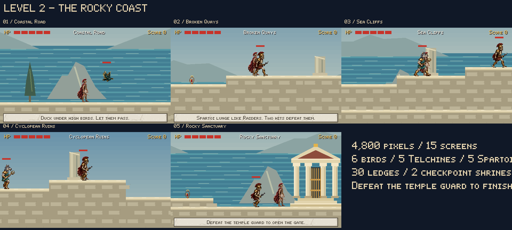

# Level 2 — The Rocky Coast

A 5,760×320-pixel ancient Greek coastline: blue sea, distant dry islands,
limestone outcrops, cypress trees, broken columns, and a sanctuary temple.
Thirty-seven broad stone ledges form two climbs and a long descent. Contiguous
landings prevent narrow gaps from trapping Theseus below the high terraces.
Uphill steps rise 16 pixels, within the existing jump; descending terraces
drop 16–48 pixels. The camera follows both axes within the taller world.



## Cinematic scenery

Level 2 uses **one continuous Aegean coastline**: connected blue sea, a single
horizon, dry offshore islands, limestone coves, and a distant sanctuary. Its
2,172×724 painting renders at 864×288 world units. It scrolls at 10% of horizontal
camera travel and 25% of vertical travel, with overscan covering the full
320-pixel-tall world through low shore, summit jumps, and descent. It never
switches paintings, wraps, blends architecture, or repeats road aprons.

Sixteen complete transparent landmarks establish the six areas: eight rocky
outcrops with coastal vegetation, four ruined quay fragments, and four
Cyclopean gateways. They stay fixed at their authored landings so their feet
cannot drift off narrow ledges as the camera moves. Cutout footing offsets
account for the transparent margins around each painting. The distant sea's
slower movement provides depth against these objects and the walkable terraces.

`scenes/levels/level_2_geometry.gd` renders `aegean_landscape.png`,
`coastal_outcrop.png`, `ruined_quay.png`, and `cyclopean_gate.png` from
`assets/art/backgrounds/level_2/`. The sea uses S3TC/ETC2 GPU compression; cutouts
remain lossless and import at a 1,024-pixel maximum dimension. All textures stay
below the project's 4,096-pixel mobile limit. Scenery has no mipmaps; the
separate repeating limestone terrain retains its existing mip chain.

Textured limestone covers all thirty-seven ledges. Stone caps, carved
waystones and the temple facade retain their existing art.
`level_1_temple.gd` keeps its bronze bars synchronized with unlocking, including
paused temple entry. The longer causeway adds seven collision pieces and three encounters; movement, bird flight heights and camera framing retain their existing rules.
All eight levels use continuous landscapes with grounded landmarks.

Standing scenery uses measured painted bases from `scenery_grounding.gd`, with
one world pixel of overlap at the ground. This closes transparent-padding gaps
under trees, ruins, pots, columns, and waystones while preserving their artwork
and collision layout. See the [ground-contact regression](performance.md#scenery-ground-contacts).

## Collapsing quay stones

Three collapsing crossings span spike pits between solid banks. Each has three limestone slabs that shed grit when stepped on, drop after half a second, and reset 2.4 seconds later. Run across or jump ahead to the next slab. Landing on the spikes costs one health. Move to either edge and jump onto the bank.

| Crossing | World X | Rim Y |
| --- | --- | ---: |
| Broken Quays | 1760–1832 | 200 |
| Sea Cliffs | 2328–2400 | 232 |
| Saltwind Causeway | 4704–4776 | 232 |

## Route

| Area | X range | Route and encounters |
| --- | --- | --- |
| Coastal Road | 0–959 | Flat approach teaches a high bird, then a low bird; short ledge climbs introduce a Telchine. |
| Broken Quays | 960–1919 | Terraces climb to y=168. Telchine jabs and Spartoi lunges share broad landings. High and low birds occupy separate lanes, and collapsing slabs cross a spike pit near the descent. |
| Sea Cliffs | 1920–2879 | A second climb with melee fights, a high bird, and another collapsing crossing. |
| Cyclopean Ruins | 2880–3839 | Low bird, Telchine, and Spartoi summit guard. Highest landing is y=104, followed by descending ledges. |
| Saltwind Causeway | 3840–4799 | Descend to a Telchine, pass a high bird and a low bird on separate landings, then climb to a Spartoi landing and the last collapsing crossing. |
| Rocky Sanctuary | 4800–5759 | Final low terraces and melee fights, then the Spartoi temple guard. |

## Enemies

| Enemy | Count | Health / score | Behavior and defense |
| --- | --- | --- | --- |
| Stymphalian Bird | 8 | 1 / 75 | Flies horizontally at 48 pixels/second, roughly half Theseus's running speed. High lanes are 44 pixels above a landing: duck in place and let the bird pass, or jump and time a sword strike. Low lanes are 8 pixels above a landing: jump forward over the approaching bird, or time a standing sword strike. |
| Telchine | 6 | 2 / 100 | Dog-headed sea daemon in Greek soldier armor. Keeps the trident in hand and jabs within 38 pixels. Its 0.35-second windup and 0.75-second attack cooldown are quicker than the Peltast’s 0.5 and 1.0 seconds, before level scaling. Jump or retreat from the jab, then counter during recovery. It never throws a weapon. |
| Spartoi | 6 | 2 / 100 | Exposed skull, ribs, and bone limbs under Greek helmet and armor. Uses Raider's committed sword lunge, tuned for this level: a 0.5-second windup, 0.22-second lunge, and 0.92-second recovery. Bait the lunge and counter. |

The eight birds comprise four high and four low lanes. The added low bird
patrols the Saltwind Causeway at x=4368–4448, eight pixels above its landing.
Birds stay at their assigned height and reverse at their patrol endpoints.
Every high-bird wing frame clears the visible ducking helmet by four pixels.
Theseus's standing and ducking collision heights are 44 and 36 pixels,
respectively, matching the visible poses so a standing player still takes a hit.
They wake within 256 horizontal and 128 vertical pixels of the player.
They deal one bar of contact damage per pass; remaining in one overlap cannot
repeat the hit. There are no projectiles or added blocking controls. Sword
damage still requires the extended-blade attack frame. Landing onto a bird
uses the existing mutual collision rule: each actor loses one health.

Spartoi reuses the tested lunge. Telchines thrust with a held trident. Art uses
four walking frames and three attack poses, matching the existing soldiers.
The birds use four wing frames. All three coastal enemies use cinematic
3D-style artwork matching Theseus: exposed skeletal Spartoi, dog-headed
Telchines with held tridents, and bronze-feathered Stymphalian Birds. Their
transparent 576×448 cells render at one-eighth scale with linear filtering,
retaining the original logical size, flight lanes, hitboxes, and animation speeds.

## Countdown, recovery, and completion

Three health flasks restore two health each.

Every attempt starts at the level entrance with full health and a **2:30 countdown**.
The timer turns red for the final 30 seconds. It freezes during pause, app
interruptions, temple entry, and completion. Running out of time opens Hades,
just like a fatal hit. **Retry Level** there restarts the entire level, including
all enemies and flasks, and restores the score carried in from earlier levels.
There are no checkpoint shrines or mid-level saves.

The title's **Load** button restarts the current level from its entrance
once Level 2 or later has been reached in this session. Replay also resets the
level and countdown. New Game resets the campaign and score to Level 1.
Session progress is held in memory; high scores are saved separately on disk.

Defeat SpartoiSanctuaryGuard to open the temple at (5712, 280). Theseus climbs
the temple steps and disappears into the doorway before the completion menu.
Replay Level restarts Level 2; New Game on the title starts Level 1 and clears
the run. Level 2 completion also offers **Continue to Level 3**, leading to
[The Sacred City](level_3.md). Entering town starts a new countdown at the Level 3 entrance.

## Run and validation

```sh
godot --path . --scene res://scenes/levels/level_2.tscn
godot --headless --path . --script res://tests/coastal_enemies.gd --fixed-fps 60
godot --headless --path . --script res://tests/level_2_smoke.gd --fixed-fps 60
godot --headless --path . --script res://tests/level_2_scenery.gd --fixed-fps 60
```

The enemy test uses Theseus's actual input, ducking shape, jump arc, attack
animation, and sword query to verify both bird lanes and their defenses. It
checks opaque sprite bounds for every high-bird wing frame at all three high
lanes, ensuring the art clears the helmet as well as the collision shape. It
also checks Telchine jabs, Spartoi lunges, recovery, and damage.

The level test covers Level 1→2 progression, entrance retry point, title restart,
actual death/reload, defeated-enemy rollback, camera limits,
completion, replay, and New Game. A route traversal with combat disabled
reaches the doorway using normal movement and 23 jumps, in about 62 simulated
seconds. Combat pacing still benefits from a human playthrough.

The scenery check sweeps the full camera route and checks viewport coverage at
the low shore, both climbs, summit jumps, and descent. It verifies one unblended,
non-repeating painting, monotonic texture sampling, sixteen complete landmarks
anchored to the world, authored ledge collisions, paused gate updates, and
isolation from the other levels.

## Extended approach

The route is 20% longer: 5,760 world units with a new Saltwind Causeway section
at X=3840–4799 before the final area. Three additional enemies occupy that
space. The countdown is 2:30, and existing music keeps looping at its
configured offset. Background camera coverage includes the full extended route.
