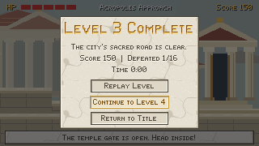

# Level 3 — The Sacred City

A 4,800×320-pixel ancient Greek town with warm plaster houses, terracotta roofs,
blue doors, shuttered windows, columned temples, colonnades, cypress trees, and
amphorae. Background buildings use muted colors; the bright marble caps of the
foreground streets and terraces identify the walkable surfaces.


| Area | World X | Route and encounters |
| --- | --- | --- |
| City Gate | 0–959 | A street-level Hoplite, then Peltast and Spartoi encounters on the first short climbs. The workshop terrace gives a clear approach to the first Lamia. |
| Potters' Quarter | 960–1919 | Lamia on a broad 320-pixel workshop landing, descending streets, a Spartoi, and a Peltast before the agora. |
| Agora Terraces | 1920–2879 | First shrine, two Hoplites along the colonnade route, and a Lamia on a 256-pixel landing. |
| Temple District | 2880–3839 | Ascending marble terraces with Peltast and Spartoi encounters, then a Lamia near the highest temple landing and a stepped descent. |
| Acropolis Approach | 3840–4799 | Peltast descent guard, second shrine, Spartoi, final Lamia landing, and the Hoplite guarding the temple exit. |

## Movement and enemies

Twenty-three terraces form fifteen uphill jumps, open courtyards, and descending
steps. Upward steps rise 16 pixels; downward steps drop 16–32 pixels. The highest
landing is y=152, 128 pixels above the street. Connected high terraces prevent
narrow gaps from trapping the player. The street catches missed jumps at lower
ledges, and the camera follows the taller route vertically.

There are four enemies of each type, sixteen total. Each has two health points,
except HopliteAcropolisGuard: gate guards from this level on are elites with three.
Lamia and Hoplites award 150 points; Spartoi and Peltasts award 100, for a maximum
combat score of 2,000. Earlier fights can be bypassed; the temple Hoplite must be
defeated to open the exit.

| Enemy | Role and counter |
| --- | --- |
| Lamia | Coils on a broad platform, telegraphs a long melee strike, then withdraws into invulnerable coils. Bait the strike and retreat, jump it, or move behind her locked facing. Wait for the coils to open before counterattacking. |
| Hoplite | Reuses the crouch, rise, march, and spear thrust behavior. Avoid body contact after he stands; time sword hits while he is exposed. |
| Spartoi | Reuses Raider's committed sword lunge. Bait the windup and counter during recovery. |
| Peltast | Reuses the held javelin's stationary melee jab. Step away or jump the telegraph, then counter. |

Lamia's workshop, agora, and temple landings provide room to back out of her
68-pixel engagement range. Her protective retreat and guard last 0.83 seconds, followed
by an exposed recovery and idle cooldown. The final Lamia is on a 192-pixel
landing. No ranged attacks, new controls, or additional enemy variants are added.

## Recovery and progression

Level 2 completion offers **Continue to Level 3**. Entering town immediately saves
its entrance at (48, 280), replacing the previous level's shrine. Title Load and
death return to that entrance until a town shrine is lit. Progress is held for
the current game session.

The Agora Shrine at x=1960 saves a safe spawn at (1984, 280). The Acropolis Shrine
at x=4096 saves (4120, 280). Each heals Theseus and snapshots this level's score,
defeated enemies, and collected flasks. Returning to an earlier shrine cannot
replace a later checkpoint. Death restores the saved snapshot, resetting later
defeats, pickups, and score gains. Five flasks restore two health bars each.

Defeating HopliteAcropolisGuard unlocks the temple at (4752, 280). Theseus climbs
the steps and fades into the doorway before the Level 3 completion menu. Replay
Level restarts the town and retains its entrance as a load point. Return to Title
keeps the latest checkpoint; New Game explicitly clears the run and starts Level 1.
Completion also offers **Continue to Level 4**, entering the
[mountain sanctuary](level_4.md) and saving its entrance as the new load point.



## Editing and validation

`scenes/levels/level_3_layout.gd` owns the route, patrols, shrines, flasks, and tips.
`level_3_geometry.gd` draws the town using the project's native geometric pixel
style and creates its terrain collisions, including editor previews. The scene
inherits the existing HUD, pause menu, checkpoint system, and temple entry flow.
The shared controller registers Lamia and labels Continue for the next level.

```sh
godot --path . --scene res://scenes/levels/level_3.tscn
godot --headless --path . --script res://tests/level_3_smoke.gd --fixed-fps 60
godot --headless --path . --script res://tests/lamia_behavior.gd --fixed-fps 60
```

The integration test checks Level 2→3 progression, the automatic entrance
checkpoint, title Load, actual death/reload, placement of all sixteen enemies,
Lamia activation on her platform, flask healing, both shrines, rollback of
post-checkpoint defeats and score, camera scrolling, temple entry, completion,
replay, and New Game. Combat is isolated during the route traversal, which uses
normal movement and fifteen jumps to reach the exit in about 52 simulated
seconds. The existing two level suites and five combat suites also pass.
Combat difficulty and first-clear pacing still need a human playthrough.
