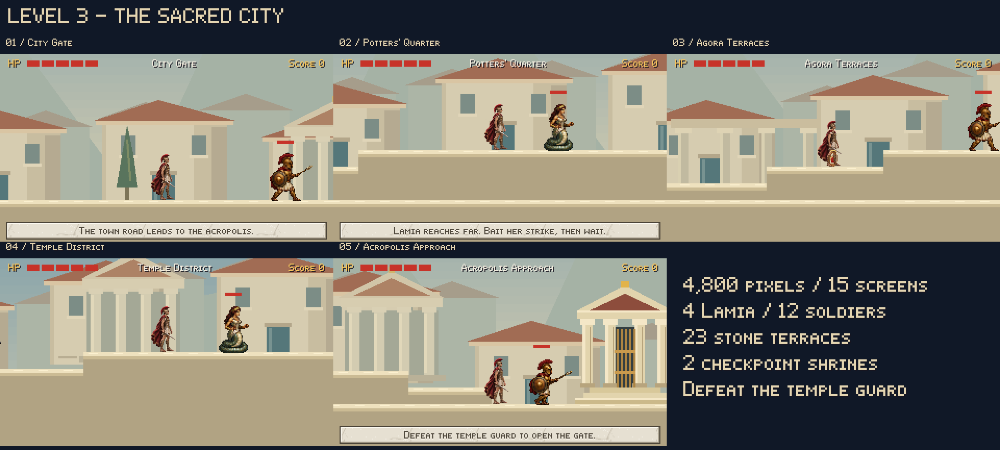

# Level 3 — The Sacred City

A 4,800×320-pixel ancient Greek town with warm plaster houses, terracotta roofs,
blue doors, shuttered windows, columned temples, colonnades, cypress trees, and
amphorae. Background buildings use muted colors; the bright marble caps of the
foreground streets and terraces identify the walkable surfaces.



## Cinematic scenery

One continuous city landscape supplies the distant roofs, temples, and hills.
Twelve complete transparent landmarks establish the route: five plaster
workshops, four shaded stoas, two olive/cypress groves, and one ruined colonnade.
They remain fixed to the original landings while the distant city scrolls at
12% of horizontal camera travel and 25% of vertical travel. The 2,172×724
painting is displayed at 864×288 world units, preserving its natural proportions
and covering the full camera range without wrapping or blending.

Cut-stone masonry covers the original twenty-three terraces. Existing amphorae
and the temple exit retain their positions and behavior.
No collision shapes, movement, encounters, or attack timing change.

Standing scenery uses measured painted bases from `scenery_grounding.gd`, with
one world pixel of overlap at the ground. This closes transparent-padding gaps
under trees, ruins, pots, columns, and waystones while preserving their artwork
and collision layout. See the [ground-contact regression](performance.md#scenery-ground-contacts).

## Route

| Area | World X | Route and encounters |
| --- | --- | --- |
| City Gate | 0–959 | A street-level Hoplite, then Peltast and Spartoi encounters on the first short climbs. The workshop terrace gives a clear approach to the first Lamia. |
| Potters' Quarter | 960–1919 | Lamia on a broad 320-pixel workshop landing, descending streets, a Spartoi, and a Peltast before the agora. |
| Agora Terraces | 1920–2879 | Two Hoplites along the colonnade route, and a Lamia on a 256-pixel landing. |
| Temple District | 2880–3839 | Ascending marble terraces with Peltast and Spartoi encounters, then a Lamia near the highest temple landing and a stepped descent. |
| Acropolis Approach | 3840–4799 | Peltast descent guard, Spartoi, final Lamia landing, and the Hoplite guarding the temple exit. |

## Movement and enemies

Lamia now matches the other characters' cinematic 3D-style artwork across eight
idle, windup, long-strike, retreat, protective-coil, and recovery poses. Her tail
anchor, world size, collision shapes, and attack timing are unchanged. Review
the poses or fight her with `godot --path . res://scenes/reviews/lamia_review.tscn`.

Twenty-three terraces form fifteen uphill jumps, open courtyards, and descending
steps. Upward steps rise 16 pixels; downward steps drop 16–32 pixels. The highest
landing is y=152, 128 pixels above the street. Connected high terraces prevent
narrow gaps from trapping the player. The street catches missed jumps at lower
ledges, and the camera follows the taller route vertically.

There are four enemies of each type, sixteen total. Each has two health points,
except HopliteAcropolisGuard: gate guards from this level on are elites with three.
Lamia and Hoplites award 150 points; Spartoi and Peltasts award 100, for a maximum
combat score of 2,000. Earlier fights can be bypassed; the temple Hoplite must be
defeated to open the exit.

| Enemy | Role and counter |
| --- | --- |
| Lamia | Coils on a broad platform, telegraphs a long melee strike, then withdraws into invulnerable coils. Bait the strike and retreat, jump it, or move behind her locked facing. Wait for the coils to open before counterattacking. |
| Hoplite | Reuses the crouch, rise, march, and spear thrust behavior. Avoid body contact after he stands; time sword hits while he is exposed. |
| Spartoi | Reuses Raider's committed sword lunge. Bait the windup and counter during recovery. |
| Peltast | Reuses the held javelin's stationary melee jab. Step away or jump the telegraph, then counter. |

Lamia's workshop, agora, and temple landings provide room to back out of her
68-pixel engagement range. Her protective retreat and guard last 0.83 seconds, followed
by an exposed recovery and idle cooldown. The final Lamia is on a 192-pixel
landing. No ranged attacks, new controls, or additional enemy variants are added.

## Recovery and progression

Five health flasks restore two health each.

Every attempt starts at the level entrance with full health and a **5:00 countdown**.
The timer turns red for the final 30 seconds. It freezes during pause, app
interruptions, temple entry, and completion. Running out of time opens Hades,
just like a fatal hit. **Retry Level** there restarts the entire level, including
all enemies and flasks, and restores the score carried in from earlier levels.
There are no checkpoint shrines or mid-level saves.

The title's **Restart Level** button restarts the current level from its entrance
once Level 2 or later has been reached in this session. Replay also resets the
level and countdown. New Game resets the campaign and score to Level 1.
Session progress is held in memory; high scores are saved separately on disk.

Defeating HopliteAcropolisGuard unlocks the temple at (4752, 280). Theseus climbs
the steps and fades into the doorway before the Level 3 completion menu. Replay
Level restarts the town; New Game explicitly clears the run and starts Level 1.
Completion also offers **Continue to Level 4**, entering the
[mountain sanctuary](level_4.md) and starting a fresh countdown.

## Editing and validation

`scenes/levels/level_3_layout.gd` owns the route, patrols, time limit, flasks, and tips.
`level_3_geometry.gd` creates the original terrain collisions and renders the
cinematic city, including editor previews. `assets/art/backgrounds/level_3/`
contains `city_landscape.png`, complete `workshop.png` and `stoa.png` cutouts,
city masonry, and the existing amphora. Groves and colonnades reuse Level 1 art.
The stone caps and temple facade reuse Level 1's art. The facade keeps its
bronze bars synchronized with unlocking, including paused temple entry. The scene
inherits the existing HUD, pause menu, level countdown, and temple entry flow.
The shared controller registers Lamia and labels Continue for the next level.

```sh
godot --path . --scene res://scenes/levels/level_3.tscn
godot --headless --path . --script res://tests/level_3_smoke.gd --fixed-fps 60
godot --headless --path . --script res://tests/level_3_scenery.gd --fixed-fps 60
godot --headless --path . --script res://tests/lamia_behavior.gd --fixed-fps 60
```

The integration test checks Level 2→3 progression, the automatic entrance
retry point, title restart, actual death/reload, placement of all sixteen enemies,
Lamia activation on her platform, flask healing, rollback of
level defeats and score, camera scrolling, temple entry, completion,
replay, and New Game. Combat is isolated during the route traversal, which uses
normal movement and fifteen jumps to reach the exit in about 52 simulated
seconds. The scenery check sweeps the full route, verifies one continuous landscape
and twelve complete landmarks, covers street level and the highest landing,
and checks unchanged terrace collisions, paused gate updates, and isolation
from the other levels.
Combat difficulty and first-clear pacing still need a human playthrough.
