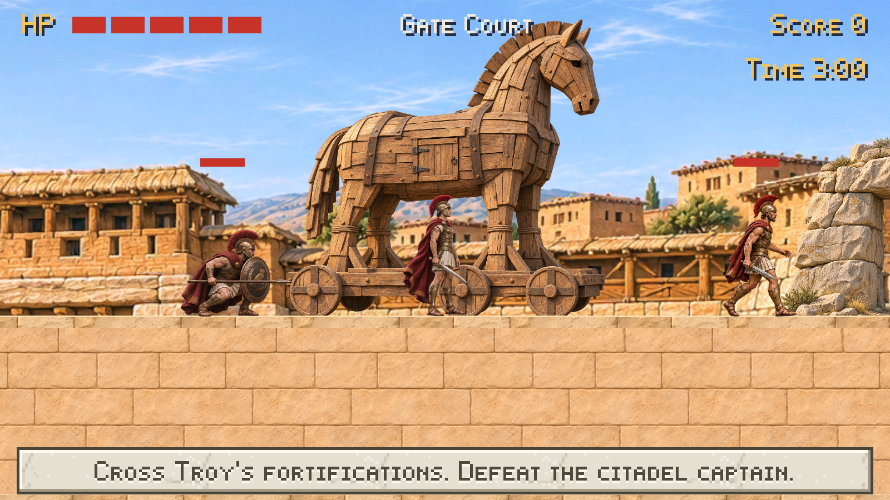

# Level 4 — Troy’s Fortifications

A 5,760×352-world-unit route along Bronze Age Troy’s defensive walls. The
three-minute countdown, combat, keyboard/mouse controls, simultaneous mobile
touch inputs, entrance retries, completion ads and results use the shared game
systems. Every climb works with normal jumps and base movement speed.



## Arrow volley

On the High Battlements at x=3600–3688, bows appear in the slits for 0.9 seconds before arrows sweep left at standing head height. Duck on the landing to let the volley pass, then run across during the three-second reload.

## Route

| Area | World X | Layout |
| --- | --- | --- |
| Trojan Plain | 0–959 | A dry approach and a gradual climb to the first wall. |
| Outer Rampart | 960–1919 | A broad fighting landing, descent and gate steps. |
| Gate Court | 1920–2879 | Two soldiers hold the courtyard before the high wall climb. |
| High Battlements | 2880–3839 | Sixteen-pixel steps reach a wide rampart at y=152, then descend. |
| Inner Wall | 3840–4799 | A broad defended wall and descent toward the citadel. |
| Citadel Gate | 4800–5759 | Final terraces, a flask and the elite Hoplite captain guarding the exit. |

Six Hoplites, seven Peltasts and six Raiders reuse existing enemy artwork and
behavior, with Level 4 difficulty tuning. Four health flasks restore two bars
each. Enemies, patrol endpoints and flasks are placed on supported terrain.
The captain unlocks the gate at (5728, 280). Finishing Troy carries the score
into [Level 5’s mountain sanctuary](level_5.md). Death, timeout, Replay and the
title’s Load restart Troy from its entrance with the carried score.

## Artwork and music

A single 2,172×724 continuous fortress panorama uses slow parallax across the
entire route. A large wooden Trojan horse stands in the gate court at X=2112. Seven
independent stone-and-timber bastions, four reused Cyclopean gateways and four retaining walls are grounded on their landings. Bright stone
caps match solid rampart geometry. The final Cyclopean gateway uses the shared
exit lock. Theseus walks along the paving and fades as he enters the doorway.
Textures stay below the 4,096-pixel mobile
limit; the opaque panorama uses desktop and mobile GPU compression.

The unmodified `assets/audio/music/IbnAl-Noor.mp3` starts at 0:00 and loops to
0:00. Troy’s completion screen and the README include this attribution:

"Ibn Al-Noor" Kevin MacLeod (incompetech.com)<br>
Licensed under Creative Commons: By Attribution 4.0 License<br>
[http://creativecommons.org/licenses/by/4.0/](http://creativecommons.org/licenses/by/4.0/)

## Play and validation

```sh
tools/play_level.sh 4
tools/play_mobile.sh 4
tools/play_mobile.sh 4 --mobile-render=540
godot --headless --path . --script res://tests/level_4_smoke.gd --fixed-fps 60
godot --headless --path . --script res://tests/level_4_smoke.gd --fixed-fps 60 -- --mobile-controls
godot --path . --script res://tests/level_4_scenery.gd --fixed-fps 60
godot --path . --script res://tests/level_4_scenery.gd --fixed-fps 60 -- --mobile-controls
godot --headless --path . --script res://tests/music_loops.gd
```

The gameplay check covers city→Troy→mountain progression, tuning, supported
placements, healing, score, Hades retry, Load, Replay, captain lock and complete
normal-jump traversal. Rendering checks cover full-route camera overscan,
landmark texture limits, rampart collision, exit facade, music attribution and
nine-level picker bounds. Physical iOS/Android delivery and performance still
require device checks.
