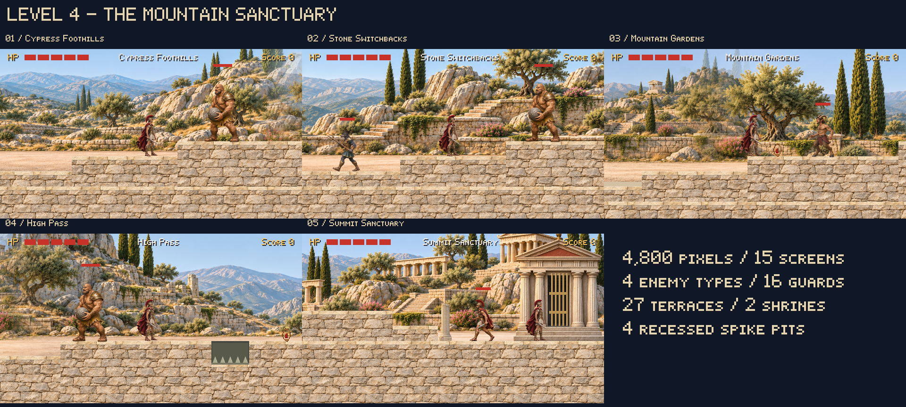
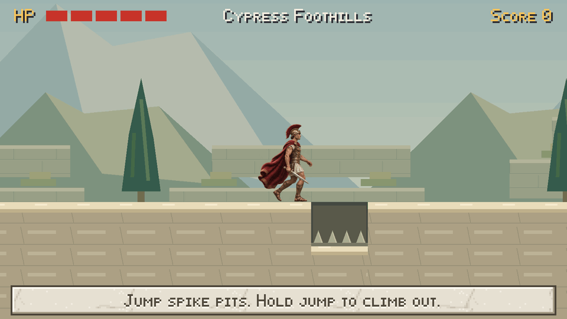

# Level 4 — The Mountain Sanctuary

A 4,800×352-pixel mountain route with layered rocky ridges, cypress trees,
terraced retaining walls, olive scrub, shrines, and a Greek sanctuary exit.
Twenty-seven main terraces climb 144 pixels above the foothill road before
descending to the summit approach. Bright stone caps mark walkable terrain;
muted slopes and smaller walls form the background.



| Area | World X | Route and encounters |
| --- | --- | --- |
| Cypress Foothills | 0–959 | An empty approach teaches the first spike pit. A Satyr occupies a broad low terrace; the first Cyclops throws from an elevated ledge. |
| Stone Switchbacks | 960–1919 | Raider and Satyr encounters lead to a wider pit. A flask follows the landing, then Telchine and Cyclops fights accompany the climb. |
| Mountain Gardens | 1920–2879 | First shrine, followed by ascending 16-pixel steps with Raider, Satyr, and Telchine encounters. |
| High Pass | 2880–3839 | A Cyclops guards the high wall. A recessed spike pit cuts the upper terrace, then the route climbs to y=136 before descending past Raider and Telchine guards. |
| Summit Sanctuary | 3840–4799 | A Satyr on the descent, second shrine, final pit, Telchine and Cyclops encounters, then the Raider guarding the sanctuary. |

## Spike pits

Four genuine recesses interrupt the terrain. The first is 32 pixels wide; the
other three are 40 pixels wide. All are 24 pixels deep. A normal held jump at
the base speed crosses each pit; stolen wine is optional. Take off near the
bright stone lip and keep moving across the gap.

Falling onto a pit's bed costs **one health bar**. The player stays in the pit:
there is no teleport or automatic escape. After landing, hold Jump and move
toward either side to clear the 24-pixel wall. The damage recoil is too small
to escape on its own. Each pit gives 1.25 seconds between damaging contacts,
in addition to Theseus's normal damage cooldown, leaving time to jump out.
Remaining on the spikes eventually costs another bar. A fatal hit uses normal
checkpoint recovery rather than creating a separate death rule.



| Pit | Left edge | Rim Y | Width / depth |
| --- | --- | --- | --- |
| FoothillPit | 304 | 280 | 32 / 24 |
| SwitchbackPit | 1344 | 280 | 40 / 24 |
| HighPassPit | 3088 | 168 | 40 / 24 |
| SummitPit | 4224 | 280 | 40 / 24 |

The terrain's collision and drawing use the same cutout definitions. Pit beds
are marked as unsafe destinations for Satyr hops. Player damage checks the
current body position as well as the detection area, preventing stale overlap
hits after exiting or loading past a pit. Pausing freezes the hazard timers.

## Enemies and recovery

| Enemy | Count | Health / score | Counter |
| --- | --- | --- | --- |
| Cyclops Slinger | 4 | 3 / 200 | A slow, committed windup launches one boulder along a fixed arc. Jump the descending boulder or destroy it with a timed sword hit. Close during the long reload opening. |
| Satyr | 4 | 2 / 125 | Varied hops use supported landing spots. Bait or jump the short horn charge, or land on its head to bounce safely and deal one damage. |
| Raider | 4 | 2 / 100 | Bait the committed sword lunge, then counter during recovery. Keeps pursuing Theseus on safe ground. |
| Telchine | 4 | 2 / 100 | A dog-headed melee fighter using the held-weapon jab. Back away or jump the windup, then counter. |

The maximum combat score is 2,100. Satyrs have a 35% chance to drop stolen wine,
which grants six seconds of 35% faster movement with a visible timer. Another
pickup refreshes the duration without stacking speed. The level's required
jumps all work without it. Six health flasks restore two bars each.

Entering from Level 3 saves the foothill entrance at (48, 280). The Mountain
Shrine at x=2048 saves a safe spawn at (2072, 280); the Summit Shrine at x=4096
saves (4120, 280). Each restores health and snapshots score, defeated enemies,
and collected flasks. Later defeats and score gains reset on death. Backtracking
cannot replace a later shrine. Title Load resumes the highest level or shrine
reached during the current session.

Defeat RaiderSummitGuard to unlock the sanctuary at (4752, 280). Theseus climbs
the steps and disappears into its doorway before the completion menu. Continue
opens [Level 5's rocky gorge](level_5.md) and saves its entrance. Replay Level
restarts Level 4, while New Game explicitly resets the campaign to Level 1.

## Play and validation

```sh
tools/play_level.sh 4
tools/play_level.sh 4 2
godot --path . --scene res://scenes/levels/level_4.tscn
godot --headless --path . --script res://tests/spike_pits.gd --fixed-fps 60
godot --headless --path . --script res://tests/level_4_smoke.gd --fixed-fps 60
```

The pit suite tests all four jumps and escapes in both directions, actual fall
damage, no automatic ejection, repeated-hit grace, pause, wine-assisted jumping,
and unsafe Satyr landing rejection. The level suite checks Level 3→4, entrance
and shrine loading, actual death/reload including fatal spike damage, enemy and
pickup placement, Cyclops engagement, the debug launcher, both shrines, checkpoint
rollback, camera scrolling, temple entry, replay, and New Game.

A traversal with combat isolated clears the entire route at normal speed in
about 52 simulated seconds, using 17 terrace jumps and four pit jumps, without
losing health. Existing level and combat regressions also pass. Combat pacing
still benefits from a human playthrough.
