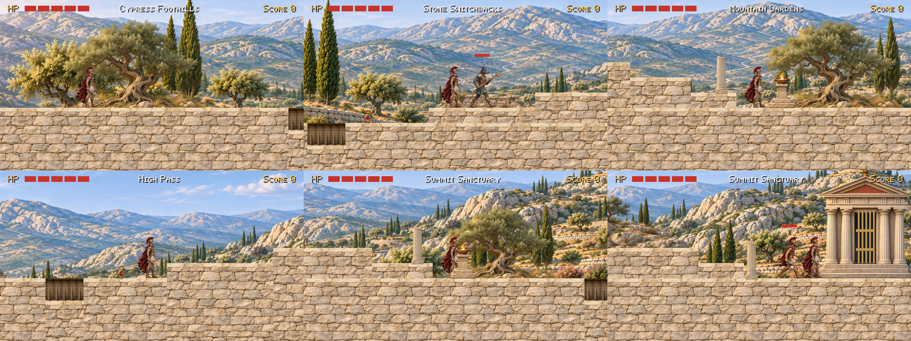

# Level 5 — The Mountain Sanctuary

A 5,760×352-pixel mountain route with layered rocky ridges, cypress trees,
terraced retaining walls, olive scrub and a Greek sanctuary exit.
Thirty-four main terraces climb 144 pixels above the foothill road before
descending to the summit approach. Bright stone caps mark walkable terrain;
muted slopes and smaller walls form the background.



## Cinematic scenery

One continuous mountain landscape shows dry rocky ridges, cypress slopes,
terraced hillsides, and a distant sanctuary. Fifteen complete transparent
landmarks stand on the route: six olive/cypress groves, five low retaining
walls, and four rocky outcrops. They stay fixed to authored landings while
the distant landscape scrolls at 10.5% of horizontal camera travel and 25% of
vertical travel. Its 2,172×724 painting fills 912×304 world units without
wrapping, panel blending, or stretched ground extensions.

All thirty-four terraces, four recessed spike pits, hazard areas, and unsafe
Satyr landing markers keep their original geometry and behavior. Scenery stays
clear of pit openings. Rustic stone, existing broken columns, and the matching temple entrance retain their gameplay roles.

Standing scenery uses measured painted bases from `scenery_grounding.gd`, with
one world pixel of overlap at the ground. This closes transparent-padding gaps
under trees, ruins, pots, columns, and waystones while preserving their artwork
and collision layout. See the [ground-contact regression](performance.md#scenery-ground-contacts).

## Route

| Area | World X | Route and encounters |
| --- | --- | --- |
| Cypress Foothills | 0–959 | An empty approach teaches the first spike pit. A Satyr occupies a broad low terrace; the first Cyclops throws from an elevated ledge. |
| Stone Switchbacks | 960–1919 | Raider and Satyr encounters lead to a wider pit. A flask follows the landing, then Telchine and Cyclops fights accompany the climb. |
| Mountain Gardens | 1920–2879 | Ascending 16-pixel steps with Raider, Satyr, and Telchine encounters. |
| High Pass | 2880–3839 | A Cyclops guards the high wall. A recessed spike pit cuts the upper terrace, then the route climbs to y=136 before descending past Raider and Telchine guards. |
| Cypress Ridge | 3840–4799 | A Telchine descent leads to a Satyr lane and a broad Cyclops landing. |
| Summit Sanctuary | 4800–5759 | A Satyr on the descent, final pit, Telchine and Cyclops encounters, then the Raider guarding the sanctuary. |

## Spike pits

Four genuine recesses interrupt the terrain. The first is 32 pixels wide; the
other three are 40 pixels wide. All are 24 pixels deep. A normal held jump at
the base speed crosses each pit; stolen wine is optional. Take off near the
bright stone lip and keep moving across the gap.

Falling onto a pit's bed costs **one health bar**. The player stays in the pit:
there is no teleport or automatic escape. After landing, hold Jump and move
toward either side to clear the 24-pixel wall. The damage recoil is too small
to escape on its own. Each pit gives 1.25 seconds between damaging contacts,
in addition to Theseus's normal damage cooldown, leaving time to jump out.
Remaining on the spikes eventually costs another bar. A fatal hit opens Hades.
Retry Level uses the same entrance restart as any other death.

| Pit | Left edge | Rim Y | Width / depth |
| --- | --- | --- | --- |
| FoothillPit | 304 | 280 | 32 / 24 |
| SwitchbackPit | 1344 | 280 | 40 / 24 |
| HighPassPit | 3088 | 168 | 40 / 24 |
| SummitPit | 4224 | 280 | 40 / 24 |

The terrain's collision and drawing use the same cutout definitions. Pit beds
are marked as unsafe destinations for Satyr hops. Player damage checks the
current body position as well as the detection area, preventing stale overlap
hits after exiting a pit. Pausing freezes the hazard timers.

## Enemies and recovery

Cyclops Slingers use cinematic 3D-style artwork across all eight ready, lift,
windup, throw, reload, and recovery poses. The larger source atlas keeps their
original world size, planted feet, collision shapes, and attack timing. Review
the poses or fight one with `godot --path . res://scenes/reviews/cyclops_review.tscn`.

Satyrs also use eight cinematic poses for breathing, hop preparation, rising
and falling hops, horn windup, charge, and recovery. Their collision shapes,
horn reach, safe bounce, and wine drops are unchanged. Review them with
`godot --path . res://scenes/reviews/satyr_review.tscn`.

| Enemy | Count | Health / score | Counter |
| --- | --- | --- | --- |
| Cyclops Slinger | 4 | 3 / 200 | A slow, committed windup launches one boulder along a fixed arc. Jump the descending boulder or destroy it with a timed sword hit. Close during the long reload opening. |
| Satyr | 4 | 2 / 125 | Varied hops use supported landing spots. Bait or jump the short horn charge, or land on its head to bounce safely and deal one damage. |
| Raider | 4 | 2 / 100 | Bait the committed sword lunge, then counter during recovery. Keeps pursuing Theseus on safe ground. |
| Telchine | 4 | 2 / 100 | A dog-headed melee fighter using the held-weapon jab. Back away or jump the windup, then counter. |

The maximum combat score is 2,100. Satyrs have a 35% chance to drop stolen wine,
which grants six seconds of 35% faster movement with a visible timer. Another
pickup refreshes the duration without stacking speed. The level's required
jumps all work without it. Six health flasks restore two bars each.

Every attempt starts at the level entrance with full health and a **3:00 countdown**.
The timer turns red for the final 30 seconds. It freezes during pause, app
interruptions, temple entry, and completion. Running out of time opens Hades,
just like a fatal hit. **Retry Level** there restarts the entire level, including
all enemies and flasks, and restores the score carried in from earlier levels.
There are no checkpoint shrines or mid-level saves.

The title's **Load** button restarts the current level from its entrance
once Level 2 or later has been reached in this session. Replay also resets the
level and countdown. New Game resets the campaign and score to Level 1.
Session progress is held in memory; high scores are saved separately on disk.

Defeat RaiderSummitGuard to unlock the sanctuary at (5712, 280). Theseus climbs
the steps and disappears into its doorway before the completion menu. Continue
opens [Level 6's rocky gorge](level_6.md) with a fresh countdown. Replay Level
restarts Level 5, while New Game explicitly resets the campaign to Level 1.

## Play and validation

```sh
tools/play_level.sh 5
godot --path . --scene res://scenes/levels/level_5.tscn
godot --headless --path . --script res://tests/spike_pits.gd --fixed-fps 60
godot --headless --path . --script res://tests/level_5_smoke.gd --fixed-fps 60
godot --headless --path . --script res://tests/level_5_scenery.gd --fixed-fps 60
```

The pit suite tests all four jumps and escapes in both directions, actual fall
damage, no automatic ejection, repeated-hit grace, pause, wine-assisted jumping,
and unsafe Satyr landing rejection. The level suite checks Level 3→4, entrance
retries, actual death/reload including fatal spike damage, enemy and
pickup placement, Cyclops engagement, the debug launcher, level score rollback, camera scrolling, temple entry, replay, and New Game.

A traversal with combat isolated clears the entire route at normal speed in
about 62 simulated seconds, using 20 terrace jumps and four pit jumps, without
losing health. Existing level and combat regressions also pass. Combat pacing
still benefits from a human playthrough.

`scenes/levels/level_5_geometry.gd` keeps the original terrain construction,
including `terrain_pieces` and spike-floor metadata, and renders the cinematic
mountains in the game and editor. `assets/art/backgrounds/level_4/` contains
`mountain_landscape.png`, the complete `terrace_wall.png` cutout, retaining
stone, and the existing column cutout. Groves and outcrops reuse Levels 1–2 art.
The stone caps and temple facade reuse Level 1's art.

The scenery check verifies one continuous landscape, fifteen complete landmarks,
clear pit openings, and full camera coverage from the foothills
to the high pass and pit bottoms, every terrain collision and cutout, spike-floor
metadata, hazard dimensions, paused gate updates, and isolation from other levels.

## Extended approach

The route is 20% longer: 5,760 world units with a new Cypress Ridge section
at X=3840–4799 before the final area. Three additional enemies occupy that
space. The countdown remains 3:00, and existing music keeps looping at its
configured offset. Background camera coverage includes the full extended route.
