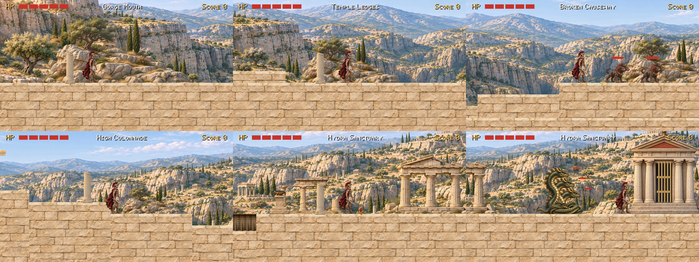

# Level 6 — The Gorge Sanctuary

A 5,760×352-pixel rocky gorge with pale limestone faces, deep dry clefts,
weathered Greek temples, broken columns, and bright stone causeways. Eighteen
main terraces climb from y=280 to the high colonnade at y=168, then descend
to the Hydra's sanctuary. Background ruins use muted stone; bright caps mark
the playable path.



## Cinematic scenery

One continuous gorge landscape shows dry stratified cliffs, distant ruins,
and a deep rocky valley. Thirteen complete transparent landmarks frame the
causeways: five ruined cliff temples, six rocky outcrops, and two colonnades.
Their painted bases stay on authored landings while the distant landscape
scrolls at 10.5% of horizontal camera travel and 25% of vertical travel. Its
2,172×724 painting fills 912×304 world units without wrapping, panel blending,
or stretched ground extensions.

All twenty-four main terraces, both one-way bull ledges and all three recessed spike pits
use the authored collision rectangles. Scenery leaves the spike openings
clear. Existing column fragments remain, and the temple
stays closed until the Hydra's final head falls, including paused entry.

Standing scenery uses measured painted bases from `scenery_grounding.gd`, with
one world pixel of overlap at the ground. This closes transparent-padding gaps
under trees, ruins, pots, columns, and waystones while preserving their artwork
and collision layout. See the [ground-contact regression](performance.md#scenery-ground-contacts).

## Retracting bridges

Three bronze decks span the spike pits at the Gorge Mouth, Broken Causeway, and Hydra Sanctuary. Each extends for three seconds, rattles for 0.8 seconds, then retracts for two seconds. Wait at the bank and run across when the deck extends. The gaps are wider than a full running jump.

## Route

| Area | World X | Route and encounters |
| --- | --- | --- |
| Gorge Mouth | 0–959 | Cross the first timed bridge to reach the broad lane that introduces the first Bronze Bull. Staggering it opens an optional route to a high flask ledge. Three low steps lead to the temple terraces. |
| Temple Ledges | 960–1919 | The first pair of Cerberus Pups holds a broad landing. Descend into a second flat bull corridor before the causeway. |
| Broken Causeway | 1920–2879 | Time the second bridge crossing, then climb 16-pixel steps. A second pup pair guards a wide terrace halfway up. |
| High Colonnade | 2880–3839 | A third bull charges along a 512-pixel causeway. A second high flask ledge rewards riding it. Descending terraces lead toward the sanctuary. |
| Western Temple Court | 3840–4799 | A long bull lane and a coordinated pup pair lead back up to the sanctuary causeway. |
| Hydra Sanctuary | 4800–5759 | The final pup pair guards the descent. Cross the last timed bridge, then defeat every Hydra head to open the exit temple. |

## Encounters

Bronze Bulls and Cerberus Pups use cinematic 3D-style artwork, with eight poses
each covering their charge, stagger, run, pounce, and recovery states. The larger
source atlases keep their original world sizes, combat timing, and collision
shapes, including the bull's ride platform. Their separate review arenas include
pose galleries: `scenes/reviews/bronze_bull_review.tscn` and
`scenes/reviews/cerberus_pup_review.tscn`.

The Hydra now uses matching cinematic coils and six head-and-neck poses. Each
jaw stays aligned with its original mouth hit area through idle, windup, bite,
retreat, and recovery. The three heads still have independent health and can be
severed separately; only defeating all three opens the exit. Review the complete
boss with `godot --path . res://scenes/reviews/hydra_review.tscn`.

| Enemy | Count | Health / score | Counter |
| --- | --- | --- | --- |
| Bronze Bull | 4 | 4 / 250 | Jump the committed charge. While airborne, hold Duck and press Sword to thrust onto its back, deal one damage, and stagger it into a temporary moving platform. |
| Cerberus Pup | 8, in four pairs | 2 / 100 each | The pair shares pursuit and takes turns making a telegraphed leap. Jump over the attack or interrupt it with a sword hit. Killing one pup leaves its partner active. |
| Hydra | 1, with three heads | 2 per head / 450 total | Each mouth has independent health. Use jumping sword attacks to reach higher heads, or counter a head as it dips into a bite. Body hits do no damage. All three heads must be defeated; severed heads stay gone. |

The maximum combat score is **2,250** across thirteen encounters. Each pup counts
separately; the Hydra counts once after its final head falls. Ordinary airborne
collisions with enemies or Hydra mouths still cost both Theseus and the target
one health. There is no automatic stomp kill.

## Optional bull ledges and spike pits

The main route has thirteen terrace climbs and three timed bridge crossings, all possible at normal movement speed. It does not require riding a bull. Two extra ledges
stand 56 pixels above the bull lanes, beyond a normal jump from the ground:

| Ledge | Span | Top Y | Flask X |
| --- | --- | --- | --- |
| Gorge Mouth | 544–656 | 224 | 616 |
| High Colonnade | 3328–3440 | 112 | 3384 |

A downward thrust on a bull's back opens a brief ride. Its cool sheen marks
the safe platform; amber warns that it is recovering. Ride toward the ledge,
then jump onto its bright stone cap. The ledges allow approach from below,
leaving the charging corridor clear. Both reward a health flask; two more
flasks sit on the main route. Each restores two health without exceeding five.

| Pit | Left edge | Rim Y | Width / depth |
| --- | --- | --- | --- |
| Gorge Mouth | 80 | 280 | 112 / 24 |
| Broken Causeway | 2016 | 280 | 112 / 24 |
| Hydra Sanctuary | 5136 | 280 | 112 / 24 |

Landing on the spikes costs one health and leaves Theseus in the pit. The
24-pixel depth allows a normal jump out: move along the pit floor toward
either wall, then hold Jump and move onto the bank. The pits retain their
112-pixel length, so use the timed bridges to cross safely. A fatal hit opens
Hades. Retry Level restarts the level from its entrance.

## Progress and the exit

Every attempt starts at the level entrance with full health and a **2:00 countdown**.
The timer turns red for the final 30 seconds. It freezes during pause, app
interruptions, temple entry, and completion. Running out of time opens Hades,
just like a fatal hit. **Retry Level** there restarts the entire level, including
all enemies and flasks, and restores the score carried in from earlier levels.
There are no checkpoint shrines or mid-level saves.

The title's **Load** button restarts the current level from its entrance
once Level 2 or later has been reached in this session. Replay also resets the
level and countdown. New Game resets the campaign and score to Level 1.
Session progress is held in memory; high scores are saved separately on disk.

HydraTempleGuard at (5568, 280) guards the temple at (5712, 280). Cutting
one or two heads leaves the gate locked. The last head awards 450 points
once and opens the gate. Theseus climbs the temple steps and disappears
inside before the Level 6 completion menu. Replay restarts Level 6, and
New Game resets the campaign to Level 1. **Continue to Level 7** enters
[the Egyptian Pyramid Road](level_7.md) with a fresh countdown.

## Play and validation

```sh
tools/play_level.sh 6
godot --path . res://scenes/levels/level_6.tscn
godot --headless --path . --script res://tests/level_6_smoke.gd --fixed-fps 60
godot --headless --path . --script res://tests/level_6_scenery.gd --fixed-fps 60
```

The integration suite checks Level 5→6, entrance retries, actual
death/reload, individual pup scoring, survivor attacks, pickup and enemy
placement, fatal spike recovery, real sword-and-jump combat against the Hydra
guard, the bull ride and high flask reward, camera scrolling, temple entry,
replay, and New Game. With combat isolated, the complete main route takes
about 63 simulated seconds and fifteen jumps without damage or a speed boost.

`scenes/levels/level_6_geometry.gd` keeps the original terrain cuts, spike-floor
metadata, and one-way ledge construction while rendering the gorge in the game
and editor. `assets/art/backgrounds/level_5/` contains `gorge_landscape.png`,
the complete `cliff_temple.png` cutout, and causeway masonry. Rocky outcrops
and colonnades reuse Levels 1–2 art. Column fragments reuse Level 5's cutout; stone caps and the temple
facade reuse Level 1's art.

The scenery check verifies one continuous landscape, thirteen complete landmarks,
clear pit openings, and full camera coverage at street level, both
bonus ledges and pit bottoms, terrain collisions, one-way settings,
spike metadata, the Hydra's three-head gate requirement, paused facade updates,
and isolation from the other levels.

## Extended approach

The route is 20% longer: 5,760 world units with a new Western Temple Court section
at X=3840–4799 before the final area. Three additional enemies occupy that
space. The countdown is 2:00, and existing music keeps looping at its
configured offset. Background camera coverage includes the full extended route.
