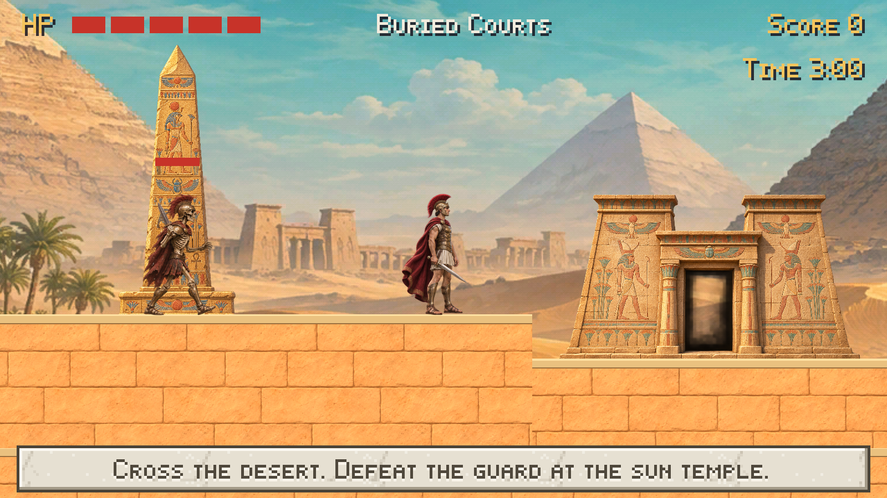

# Level 6 — The Pyramid Road

Theseus crosses an Egyptian desert between the Gorge Sanctuary and Atlantis.
Pyramids, dunes, carved obelisks and sandstone pylon gateways frame the route.
The level reuses Hoplites, Peltasts, Raiders and Spartoi, including their existing
artwork, attacks, counters and score rewards. No new enemy type is introduced.



## Route

The 4,800×352-unit route begins at (48, 280) and ends at the sun temple at
(4640, 280). Twenty-two sandstone terraces use sixteen-unit rises, with a
continuous lower floor beneath them. Normal jumps reach every required landing;
there are no pits, water, riding requirements or changes to player movement.
The highest landing is at Y=200, eighty units above the desert road.

| Section | World X | Encounters and route |
| --- | --- | --- |
| Desert Road | 0–959 | Raider, Peltast and the first sandstone climb. |
| Pyramid Causeway | 960–1919 | Hoplite and Spartoi, a lower Raider court, then a Peltast climb. |
| Buried Courts | 1920–2879 | Spartoi and Hoplite landings, a recovery flask, then a Raider on the ascent. |
| Obelisk Rise | 2880–3839 | Recovery flask, a Peltast/Hoplite pair on the high court, then Spartoi on the descent. |
| Temple of the Sun | 3840–4799 | Raider, Peltast and Spartoi precede the elite Hoplite captain and the temple. |

## Encounters and healing

Four of each requested enemy type make sixteen encounters. All receive the
existing Level 6 difficulty curve once. The sun captain alone receives the
standard elite health bonus: three hits during vulnerable states defeat him.
His existing crouch and rise still block sword hits. Bait the attack and counter
during recovery. Defeating him unlocks the temple gate.

Four flasks restore two health bars each, at (1216, 248), (2400, 280),
(2944, 216) and (4000, 280). Full health leaves a flask available for later.
The existing campaign heuristic rates Egypt at about 32.8, between the gorge's
27.4 and Atlantis's 36.6. This estimates content pressure; it does not replace
human combat play testing.

## Campaign, controls and results

The gorge offers **Continue to Level 6**. Finishing Egypt shows a ready ad before
results on mobile, then **Continue to Level 7** enters [Atlantis](level_7.md).
The [Minotaur finale](level_8.md) is Level 8.

Each attempt starts with full health and a 3:00 countdown. Pause, app
interruptions, temple entry, the ad and results freeze the clock. Death or time
expiry opens Hades; Retry Level restores the Egyptian entrance, enemies,
flasks and score carried from earlier levels. Replay and the title's Restart
Level also restart the attempt. There are no checkpoints.

Desktop keyboard/mouse controls and simultaneous mobile touch controls use the
shared player and UI. The camera follows the climbs within the existing bounds.

## Artwork and rendering

One continuous 2,172×724 desert painting supplies the dunes and pyramids.
Six complete obelisks and four pylon gateways stay anchored to the terrain;
only the distant painting uses parallax. The exit's Egyptian pylon replaces the
Greek facade while retaining the shared gate collision and doorway animation.

The opaque landscape uses desktop and mobile GPU compression. Transparent props
remain lossless, with measured painted-base anchors and textures below the
4,096-pixel mobile limit. Existing native, 720p, 540p and preview rendering
profiles are shared with the rest of the campaign. The existing Ancient Egypt
Historical Epic track is reused; music credits are in the README.

## Play testing

```sh
tools/play_level.sh 6
tools/play_mobile.sh 6
tools/play_mobile.sh 6 --mobile-render=540
godot --headless --path . --script res://tests/level_6_smoke.gd --fixed-fps 60
godot --headless --path . --script res://tests/level_6_smoke.gd --fixed-fps 60 -- --mobile-controls
godot --path . --script res://tests/level_6_scenery.gd --fixed-fps 60
godot --headless --path . --script res://tests/difficulty_curve.gd
```

The gameplay check covers gorge→Egypt→Atlantis progression, recycled enemy
placement and scaling, healing, Hades retry, title restart, replay, the complete
route using normal jumps, countdown and the captain's gate. The scenery check
covers camera overscan, texture limits, terrace collisions and the Egyptian exit.
Campaign-wide rendering, painted-base grounding, countdown and ad tests include
all eight levels where applicable. Native iOS/Android delivery and physical
device performance still require device checks.
