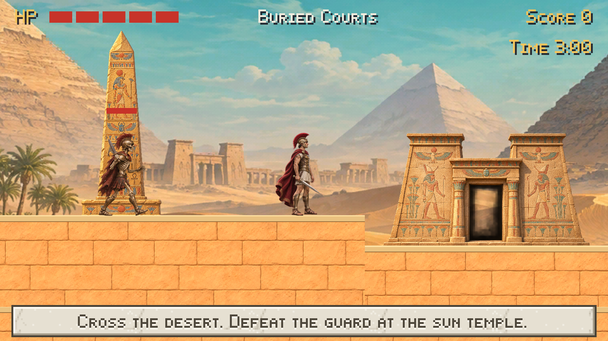

# Level 7 — The Labyrinth

The final level follows Atlantis. Theseus enters a dim stone labyrinth, fights
Hoplites, Peltasts, and Raiders, and defeats the Minotaur to escape. The existing
320×180 world coordinates, movement, jump, duck, sword, and touch controls apply.



## Route

The 4,800×352-unit route starts at (48, 280) and ends at (4752, 280).
Seventeen terraces create eleven upward jumps, with rises of sixteen units.
The continuous lower floor catches missed jumps. Two low-roofed corridors have
56 units of clearance; Theseus walks through using his existing standing body.
Ducking still holds position, as it does elsewhere in the game.

| Section | World X | Encounters and route |
| --- | --- | --- |
| Gates of Knossos | 0–959 | Arrival corridor, Raider, two short climbs, Hoplite. |
| Twisting Galleries | 960–1919 | Peltast, raised Raider gallery, descent past a Peltast, first low lintel. |
| Hall of the Bull | 1920–2879 | Hoplite, four climbs, Raider/Peltast pair and recovery flask. |
| Ariadne's Passage | 2880–3839 | Hoplite, low-roofed passage, raised Raider/Peltast pair, final Hoplite. |
| The Minotaur's Lair | 3840–4799 | Broad flat charge arena, locked exit. |

There are four of each soldier, one Minotaur, and three two-health flasks.

Every attempt starts at the level entrance with full health and a **5:00 countdown**.
The timer turns red for the final 30 seconds. It freezes during pause, app
interruptions, temple entry, and completion. Running out of time opens Hades,
just like a fatal hit. **Retry Level** there restarts the entire level, including
all enemies and flasks, and restores the score carried in from earlier levels.
There are no checkpoint shrines or mid-level saves.

The title's **Restart Level** button restarts the current level from its entrance
once Level 2 or later has been reached in this session. Replay also resets the
level and countdown. New Game resets the campaign and score to Level 1.
Session progress is held in memory; high scores are saved separately on disk.

## Minotaur

The boss has eight health, including the existing elite gate bonus applied once.
Each sword hit or ordinary body collision removes one health. Body collisions
also cost Theseus one health; landing on the boss is not a free stomp kill.

| State | Behavior |
| --- | --- |
| Wind-up | Plants his hooves, lowers his horns, and commits to a direction. A bronze ground cue reinforces the warning. |
| Charge | Rushes at 126 world units/second for at most 1.1 seconds. His collision height lowers to 28 units, allowing a correctly timed full jump over his back. The charge does not track a jumping player. |
| Headbutt | Stops near a grounded player, at an arena edge, or when the charge ends. A short horn strike deals one damage at most once per attack. Terrain blocks the strike. |
| Recovery | Recoils with exposed chest. Sword hits deal one damage without restarting the recovery or cancelling his whole attack cycle. |
| Backstep | Steps backward while still facing Theseus, then lines up another wind-up. He stops before leaving the arena or walking into terrain. |

All soldiers and the boss receive the existing Level 7 difficulty curve. Boss
wind-up uses the authored 1.15 seconds, recovery 1.45 seconds, and backstep/rest
the existing timing helpers, which preserve minimum warning and counter windows.
The campaign heuristic scores Level 7 at approximately 42.2 versus Atlantis's
33.1, a 27% increase. This is a content estimate; combat pacing needs human play
testing. Jump as the charge approaches, cross over the lowered body, and counter
after the headbutt. A sword hit does not interrupt the committed charge.

The exit remains locked until the eighth hit defeats the boss. Theseus then
enters the existing doorway sequence and reaches **Theseus Victorious**.
The final menu offers Replay and Return to Title.
It also shows the persistent local top-five scores, highlighting this victory's
score in gold with a **YOU** marker when it qualifies. Earlier level completions
do not submit scores; Hades records each life when Theseus dies.

## Art and lighting

One continuous interior painting shows connected corridors, bull reliefs,
pillars, and Greek stonework. It uses the same restrained horizontal/vertical
parallax and overscan as the other rebuilt backgrounds, with no panel blending.
A bronze thread marks the traversable floor.

Six animated bronze torches are pinned to authored points on the painted wall.
Their brackets, flames, and lights share the wall's horizontal and vertical
parallax, so the stonework cannot slide behind them. They stay behind foreground
terrain and cast warm, gently flickering light over cool ambient shadows.
Only nearby lights are visible, each uses one shared
128×128 radial gradient, and shadows are disabled. No full-screen lighting
shader, runtime image processing, or additional render target is introduced.
HUD and touch controls remain outside the darkened world canvas.

The painting imports with desktop/mobile GPU compression. Minotaur and torch
atlases retain lossless alpha and fit the 4096-pixel mobile texture limit.
The boss has eight poses; torch flames have four. These assets were generated
with the built-in imagegen tool. Desktop keeps native rendering; mobile keeps
the existing 720p/540p budgets and separate simulator preview.

## Play testing

```bash
tools/play_level.sh 7
tools/play_mobile.sh 7
```

Use the ordinary jump and sword
buttons; no new input is required.

```bash
godot --headless --path . --script res://tests/minotaur.gd --fixed-fps 60
godot --headless --path . --script res://tests/level_7_smoke.gd --fixed-fps 60
godot --headless --path . --script res://tests/difficulty_curve.gd
godot --path . --script res://tests/mobile_rendering.gd --fixed-fps 60 -- --mobile-controls
```

The route test isolates combat to check all eleven jumps, both corridors,
entrance progression, gate locking, final victory, and replay. The boss test
separately uses actual player movement and sword attacks to check charge
clearance and damage, plus attack ordering, focus, retreat, pause, and defeat.

Validation passed for the boss and route with desktop and mobile controls,
existing player combat, complete character frames, all seven scenery layouts,
and 720p/540p/preview render profiles with HUD, safe-area, and resize checks.
The native iOS Simulator displayed the boss, Theseus, torches, and touch controls
at both preview and 720p; it reported three visible torch lights. Its renderer
was Apple Software Renderer, so these checks do not establish phone performance.
An isolated stock-template Android debug APK also exported successfully; native
Android gameplay, production Gradle/ads, and physical phone performance remain
unverified. The normal iOS campaign app was restored after the probe.
