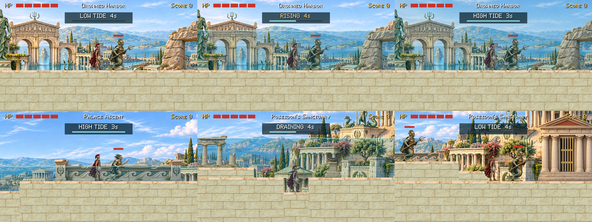

# Level 8 — Atlantis

Level 8 is playable. Cross a partially flooded Atlantean city, fight Merfolk,
and defeat their captain to enter Poseidon's sanctuary. The 5,760×352-unit
route uses the existing movement and combat controls on desktop and mobile.



## Setting and play

Theseus enters a partially flooded Atlantean city and fights through its tidal
causeways to Poseidon's sanctuary. Turquoise canals, pale marble, oxidized bronze,
wave carvings, submerged colonnades, and a distant ringed palace distinguish
Atlantis from the earlier rocky coast. The art keeps the detailed cinematic
style and side view established by Theseus and the rebuilt scenery.

The causeways repeatedly flood and drain. Theseus keeps his existing jump,
duck, sword timing, gravity, and five health bars, but water reduces horizontal
movement and walk-animation cadence by up to 30%. Merfolk keep their full
Level 8-scaled movement and attack speeds. Water causes no damage; there is
no oxygen timer, swimming input, buoyancy, or current. The two recessed canal
beds are still harmless and escapable in either direction.

## Atlantis tide

| Phase | Duration | Water behavior |
| --- | ---: | --- |
| Low tide | 4 seconds | Surface rests at y=304; the causeways are dry and the canal puddles remain. |
| Filling | 8 seconds | Water smoothly rises to y=128, progressively covering the low route. |
| High tide | 6 seconds | The lower causeways are submerged. The highest palace landing has shallower water and less drag. |
| Draining | 8 seconds | Water smoothly falls back to the canal beds, restoring normal movement. |

The 26-second cycle repeats. A meter below the area title shows the tide phase,
remaining seconds, and water height. An animated surface, ripples, and sparse
bubbles make filling and draining visible. Water is clipped to open space above
the authored terrain so stone lips and canal openings stay clear.

Drag starts after eight units of immersion and reaches its maximum at 32 units.
Theseus moves at 90 units/second on dry ground and 63 in deep water. Jumping
out of the water restores speed immediately. Jump height, gravity, sword hit
frames, and attack duration stay unchanged. Wine's 35% speed bonus still applies
once on top of the water multiplier.

Higher ground gives partial relief during high tide. Players can press through
with slower retreats, reposition toward a higher landing, or wait for drainage.
Every required climb and both canal jumps remain possible even at maximum
flood. Pause freezes the tide; Replay, title Load, and death/reload begin a new
low tide at the level entrance. Water drag cannot persist into other
levels.

The movement design uses the existing 320×180 world coordinates, 90-unit dry run
speed, -260 jump velocity, and 900 gravity. A full jump rises about 37.6 world
units before collision and frame-step effects. Required upward steps are 16
units; the two canal recesses are 24 units deep and 32/40 units wide, matching
sizes already used by the game's escapable pits. Traversal is checked with the real controller, including full-height touch
jumps in the combat regression.

## Water jets

On the Outer Ring Causeway at x=4020–4100, bubbles mark the vents for one second before the jets erupt for one second. Four seconds of calm give Theseus time to cross even at high tide. The vents have their own cycle.

## Route

The world is 5,760×352 units, starting at (48, 280) and ending at
(5712, 280). It has twenty-seven connected raised terraces, eighteen upward
steps, two shallow canal jumps, and a summit at y=152. Descending steps drop
16–32 units. The lower causeway catches missed jumps. There are no required
moving platforms or timed jumps.

| Area | World X | Route and first-clear purpose |
| --- | --- | --- |
| Drowned Harbor | 0–959 | A quiet arrival quay, a lone trident guard with room to duck or retreat, then two short climbs and another guard. Teach the new silhouette before combining it with difficult terrain. |
| Ring Canals | 960–1919 | A broad upper landing introduces the blade fighter. Descend past a trident guard, cross the first shallow canal, then climb to another broad combat landing. |
| Sunken Agora | 1920–2879 | A quiet courtyard precedes a stair climb. A trident guard and a later blade fighter occupy separate landings; a flask follows the fight. |
| Palace Ascent | 2880–3839 | Climb to the highest palace terrace for an isolated blade fight. Descend through two trident-guard landings, with recovery space between them. |
| Outer Ring Causeway | 3840–4799 | A trident landing, a raised Reefblade and a lower trident quay extend the outer ring. |
| Poseidon's Sanctuary | 4800–5759 | Descend to the second canal, then a broad causeway. Fight a blade fighter, a trident guard, and finally the elite Merfolk captain guarding the exit. |

The raised terrain is listed below. All dimensions use world units;
each terrace extends down to the main causeway at y=280. The lower route is
solid except for the two explicitly recessed canal beds.

| Terrace X span | Top Y | Width |
| --- | ---: | ---: |
| 640–752 | 264 | 112 |
| 752–960 | 248 | 208 |
| 960–1216 | 232 | 256 |
| 1216–1328 | 248 | 112 |
| 1328–1440 | 264 | 112 |
| 1552–1664 | 264 | 112 |
| 1664–1920 | 248 | 256 |
| 1920–2032 | 264 | 112 |
| 2160–2272 | 264 | 112 |
| 2272–2384 | 248 | 112 |
| 2384–2640 | 232 | 256 |
| 2640–2752 | 216 | 112 |
| 2752–2880 | 200 | 128 |
| 2880–2992 | 184 | 112 |
| 2992–3104 | 168 | 112 |
| 3104–3424 | 152 | 320 |
| 3424–3552 | 184 | 128 |
| 3552–3680 | 216 | 128 |
| 3680–3840 | 248 | 160 |
| 3840–3968 | 264 | 128 |
| 4160–4272 | 264 | 112 |
| 4272–4496 | 248 | 224 |
| 4496–4608 | 264 | 112 |
| 4800–4928 | 264 | 128 |
| 5280–5392 | 264 | 112 |
| 5392–5536 | 248 | 144 |
| 5536–5584 | 264 | 48 |

| Shallow canal | Left X | Rim Y | Width / depth | Bed Y |
| --- | ---: | ---: | --- | ---: |
| Ring Canal | 1472 | 280 | 32 / 24 | 304 |
| Sanctuary Canal | 4976 | 280 | 40 / 24 | 304 |

The recesses have real terrain cuts and visible bright rims. At low tide, shallow water remains over the beds; there is neither a damage
trigger nor an invisible bridge. Both allow jumping out in either direction. Scenery bases leave the openings
clear. Pause freezes any water animation.

## Merfolk

Merfolk have scaled humanoid torsos, finned ears, webbed hands, bronze Greek
armor, and a single fish tail ending in two flukes. They brace and propel their
tails along wet stone; they do not walk on human legs or hover over the floor.
Their measured tail bases remain planted across all eight animation poses. Weapons
and crests distinguish their roles without relying on color alone.

There are two regular combat roles and one elite of the trident role. Both
regular roles start with two health; the captain receives the existing gate
elite bonus once, for three. Every attack deals one health. Ordinary body
collisions, including landing on a Merfolk, retain the existing one-health
trade for both characters. These are not safe-bounce enemies.

| Role | Count | Score each | Read and counter |
| --- | ---: | ---: | --- |
| Merfolk Trident Guard | 10 | 125 | Raises a held trident, then makes one stationary high thrust. Duck underneath or back away; stand and counter during recovery. |
| Merfolk Reefblade | 5 | 150 | Lowers a short bronze blade and coils its tail before a short, committed ground lunge. Jump over the weapon or retreat, then counter. Ducking does not avoid this low attack. |
| Merfolk Gate Captain | 1 | 250 | Reuses the trident guard's readable attack, with an additional bronze fin crest and three health. Defeating it opens the sanctuary. |

The maximum combat score is **2,250**. The captain must be defeated to finish the level. No Merfolk throws
its weapon, fires a projectile, or requires a new block/dodge input.

### Attack timing and pursuit

These are play-test tuning values, subject to combat review. The
existing difficulty curve applies once. At Level 8 it currently scales windup
by approximately 0.766, recovery by 0.784, cooldown by 0.719, and movement speed
by 1.091. The existing minimum timing floors remain in effect.

| Behavior | Authored value | Approximate Level 8 value |
| --- | --- | --- |
| Trident windup / active / recovery / cooldown | 0.70 / 0.18 / 1.10 / 1.25 seconds | 0.54 / 0.18 / 0.86 / 0.90 seconds |
| Trident pursuit speed | 26 units/second | 28.4 units/second |
| Reefblade windup / active / recovery / cooldown | 0.65 / 0.18 / 1.05 / 1.25 seconds | 0.50 / 0.18 / 0.82 / 0.90 seconds |
| Reefblade pursuit speed | 30 units/second | 32.7 units/second |
| Reefblade attack travel | 18 units over 0.18 seconds | Same committed travel |

A trident thrust must actually clear the duck pose. Theseus's current standing
and crouching bodies are 44 and 36 units high. The high strike band is
38–44 units above a shared flat landing, with at least two units above the
ducked body. Guards engage only when the fighters' feet are effectively level and never
retarget downward onto a crouching player. The visible trident and Theseus's
painted ducked head must also clear at preview, 540p, 720p, and desktop sizes.
Theseus's body shapes are unchanged. A straight jump cannot reliably clear
this high band; duck or retreat from a trident. Crouching currently prevents sword attacks, so the counter
comes after releasing Duck during the long recovery.

Reefblades are smaller than trident guards and use a 36-unit body. Their attacks occupy a low band that overlaps both standing and crouched
Theseus. Their ground travel stays fixed after windup. Jumping must clear the
weapon and body; landing on the fighter still counts as a collision. Windup
and attack direction lock together, and each committed attack can damage the
player at most once. Recovery is vulnerable, with no hidden invulnerability.

Both roles keep focus through attacks, recovery, and nearby jumps. They resume
safe pursuit or face Theseus while waiting at an edge; they do not turn back
into their patrol after a hit. Reuse the existing focus range, line-of-sight,
wall, and floor checks. Neither attack can pass through terrain, cross a canal,
or carry its owner off a landing. Nearby encounters use separate landings to keep the first play-test version
from depending on simultaneous attack juggling.

### Encounter positions

These are play-test placements, with feet on the authored route. Patrol extents
must remain inside the same safe landing, clear of canal beds.
The 256/320-unit upper landings provide room for the first three blade fights;
the fourth occupies the new outer ring, and the fifth uses the broad lower causeway near the sanctuary.

| Area | Encounters (X, Y) |
| --- | --- |
| Drowned Harbor | Trident (384, 280), Trident (848, 248) |
| Ring Canals | Reefblade (1088, 232), Trident (1368, 264), Trident (1760, 248) |
| Sunken Agora | Trident (2328, 248), Reefblade (2512, 232) |
| Palace Ascent | Reefblade (3264, 152), Trident (3600, 216), Trident (3744, 248) |
| Outer Ring Causeway | Trident (3896, 264), Reefblade (4368, 248), Trident (4712, 280) |
| Poseidon's Sanctuary | Reefblade (5216, 280), Trident (5456, 248), Captain (5632, 280) |

## Recovery and progression

Two health flasks at (888, 248) and (2800, 200) restore two health each, up to five.

Every attempt starts at the level entrance with full health and a **3:00 countdown**.
The timer turns red for the final 30 seconds. It freezes during pause, app
interruptions, temple entry, and completion. Running out of time opens Hades,
just like a fatal hit. **Retry Level** there restarts the entire level, including
all enemies and flasks, and restores the score carried in from earlier levels.
There are no checkpoint shrines or mid-level saves.

The title's **Load** button restarts the current level from its entrance
once Level 2 or later has been reached in this session. Replay also resets the
level and countdown. New Game resets the campaign and score to Level 1.
Session progress is held in memory; high scores are saved separately on disk.

The captain at (5632, 280) guards the exit at (5712, 280). Three sword hits
defeat the captain. Theseus enters the doorway using the existing steps and
fade sequence. Egypt (Level 7) offers **Continue to Level 8**. Atlantis completion offers
**Continue to Level 9**, entering the final [labyrinth](level_9.md), alongside
Replay and Return to Title.

## Scenery and platform budgets

One continuous 2,172×724 painting shows the ringed city, sea, palace, and
submerged ruins. It fills 912×304 world units with 10.5% horizontal and 25%
vertical camera travel. Overscan covers the full route, summit jumps, and canal
bottoms without panel joins, wrapping, or reflected strips.

Fifteen complete transparent landmarks include six wave-carved walls, five
bronze Poseidon statues, two reused coastal arches, and two ruined colonnades.
Their measured painted bases use `scenery_grounding.gd` and sit on wide, flat
landings clear of canals. Warm stone caps mark walkable terrain against cooler
turquoise water and distant ruins. The exit retains a distinct, functional
temple doorway.

Low-tide puddles are seven units deep over each canal bed. The cycling tide
adds visible water strips, surface lines, and sparse bubbles over open terrain,
without a new viewport, full-screen refraction shader, or real-time reflection.
Opaque scenery uses supported S3TC/ETC2 imports; the two 1,881×836 Merfolk
atlases, transparent props, fonts, and UI stay lossless. New scenery cutouts
have a 1,024-pixel import cap. Terrain reuses the existing city masonry and its
mipmaps. The 720p/540p phone profiles and simulator preview are unchanged.

## Play testing and validation

```sh
tools/play_level.sh 8
tools/play_mobile.sh 8                  # desktop touch preview
tools/play_mobile.sh 8 --mobile-render=540
godot --path . res://scenes/reviews/merfolk_review.tscn
godot --headless --path . --script res://tests/merfolk_behavior.gd --fixed-fps 60 -- --mobile-controls
godot --headless --path . --script res://tests/atlantis_tides.gd --fixed-fps 60 -- --mobile-controls
godot --headless --path . --script res://tests/level_8_smoke.gd --fixed-fps 60
godot --headless --path . --script res://tests/level_8_scenery.gd --fixed-fps 60
```

The review arena switches between Guard, Blade, and Captain. Gallery pauses
combat and displays all eight poses beside Theseus; Reset restores the fight.
The combat check exercises real weapon collision queries, standing/duck/jump/
retreat counters, actual sword attacks, full touch jumps, one damage per attack,
locked facing, focus, wall and edge safety, scores, captain health, and review
controls. It independently inspects the imported painted tail contacts.

The integration check covers Level 7→8, the entrance, title Load,
death/reload, supported enemy and flask placements, level score rollback, the captain-locked gate, entry, completion, replay, and New Game.
With combat isolated and the tide cycling, the full course takes about 74.7
simulated seconds and 20 jumps. Both canals are harmless and escapable in either direction; pause
freezes their water animation. The scenery check sweeps the camera route and
extremes, checks every terrace and canal cut, and leaves openings unobscured.
Shared scenery, texture, and mobile checks include all nine levels.

Human play testing should assess whether the first trident clearly teaches
Duck, the blade telegraph gives enough time to jump, and the two-flask pacing
feels fair. Keep Intel Simulator software-rendering results separate from
physical-phone performance.

The tide regression checks the actual spawned enemies' Level 8 tuning, full
Merfolk speeds across all phases, continuous fill/drain, dry and wet player
travel, higher-ground relief, wine composition, identical jump height and sword
frames, all eighteen climbs and both canal jumps at maximum flood, pause,
entrance retry, replay, and other-level isolation. Touch checks cover a
jump-to-sword thumb transition and indicator safe areas. The rendered profile
check also compares underwater movement and sword histories at native, preview,
540p, and 720p settings.

## Extended approach

The route is 20% longer: 5,760 world units with a new Outer Ring Causeway section
at X=3840–4799 before the final area. Three additional enemies occupy that
space. The countdown remains 3:00, and existing music keeps looping at its
configured offset. Background camera coverage includes the full extended route.
